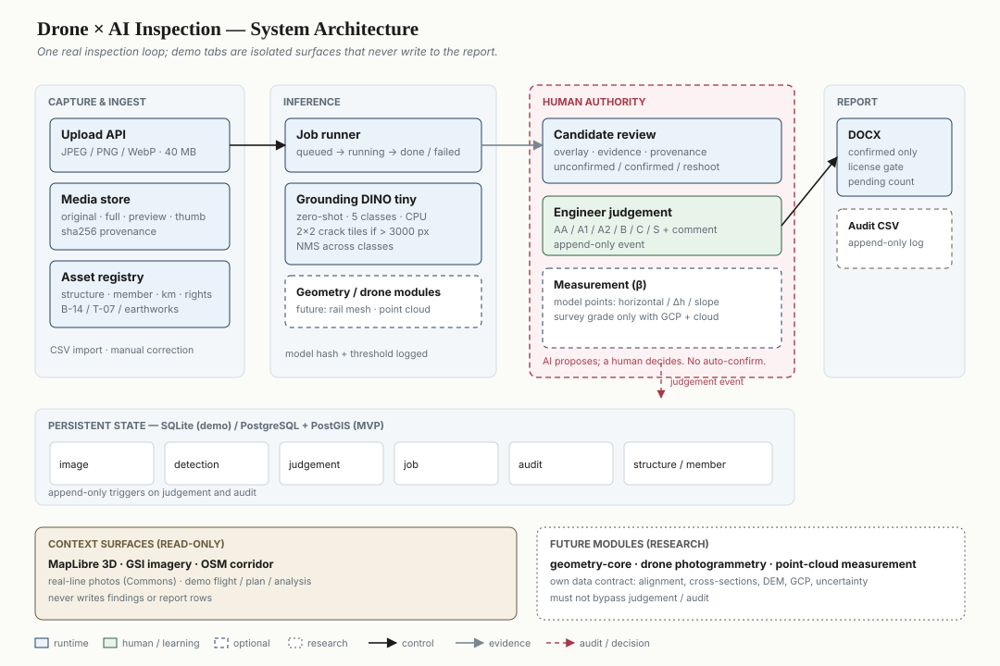
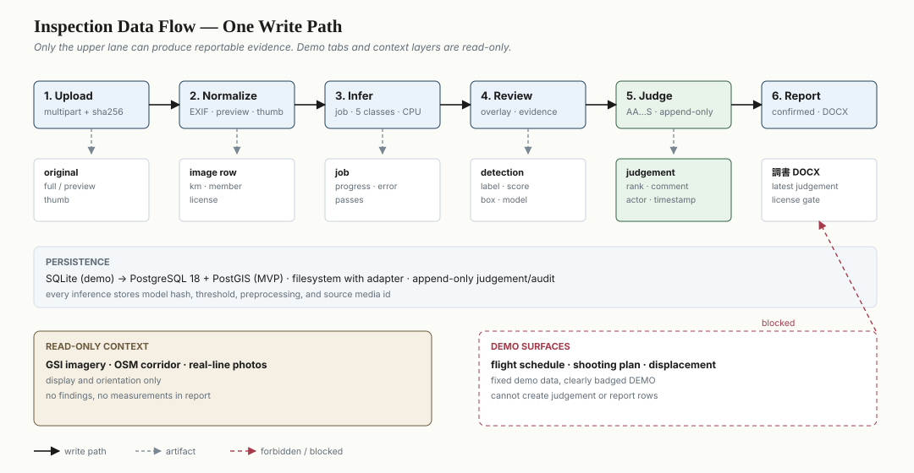

# Architecture — Drone × AI Inspection

Cập nhật: 2026-11-23. Tài liệu này là bản đồ module và luồng dữ liệu của app hiện tại, kèm các điểm mở rộng đã chuẩn bị cho geometry và xử lý ảnh drone.



## 1. Nguyên tắc

1. **Một write path duy nhất**: upload → infer → engineer judgement → 調書. Chỉ judgement đã xác nhận mới đi vào báo cáo.
2. **Demo không ghi**: 飛行スケジュール / 撮影計画 / 変位解析 là dữ liệu cố định, có nhãn `DEMO`; không tạo finding/judgement/report row.
3. **Người quyết định**: AI chỉ sinh candidate; `judgement` là append-only, có trigger DB chặn UPDATE/DELETE.
4. **Truy vết**: mỗi detection lưu model hash/version, score, box, media; mỗi ảnh lưu sha256, license, nguồn.
5. **Bối cảnh ≠ đo đạc**: 3D MapLibre là bối cảnh; view 計測 hiện dùng điểm mô hình và ghi rõ `模式値`.

## 2. Cây module

```text
backend/
  app/
    main.py            # entry: from .api import app
    api.py             # FastAPI app + HTTP routes + static mount
    config.py          # paths, model id, classes, limits, asset seed
    db.py              # SQLite connection, schema, seed, audit
    inference.py       # Grounding DINO, tiling/NMS, job runner
    schemas.py         # request models (judgement, image patch)
    pointcloud.py      # synthetic cloud metadata + pick/reprojection
    services/
      media.py         # normalize, preview, thumb
    modules/
      geometry/        # future: alignment -> cross-sections -> GLB/3D Tiles
      drone/           # future: video frames, photogrammetry, point cloud
  scripts/
    detect_batch.py    # offline batch inference
    backup.py          # SQLite snapshot + media tar.gz
frontend/
  src/
    app/App.tsx        # shell, tab state, review flow
    components/MapView.tsx
    features/
      schedule/ plan/ analysis/ priority/
      shared.ts
    lib/
      i18n.ts geo.ts railContext.ts
    styles/
      workspace-theme.css  # Databricks-style tokens
      app.css
data/                  # runtime data (ignored except demo seed)
docs/                  # research, requirements, diagrams
```

Quy tắc phụ thuộc:

- `api.py` được import `db`, `inference`, `schemas`, `services.media`; không import ngược.
- `inference.py` không biết HTTP; chỉ nhận job id/image id/path.
- `modules/*` là package độc lập, chỉ giao tiếp qua input/output contract; không ghi trực tiếp vào `judgement`.
- Frontend `features/*` không gọi DB; chỉ gọi `/api` và nhận type từ `lib`.

## 3. Runtime topology

```text
Browser (React)
  ├─ /api/*            FastAPI (backend.app.main:app)
  ├─ /assets, /rail/*  static build + context photos
  └─ MapLibre          GSI tiles + OpenFreeMap buildings (internet)

FastAPI
  ├─ SQLite data/demo.db (WAL)
  ├─ data/originals | uploads | previews | thumbs
  └─ inference thread (CPU, serialized by a lock)
```

Deploy demo: một process Uvicorn + static build. MVP: PostgreSQL/PostGIS, worker tách khỏi API, storage adapter, backup định kỳ (xem `docs/research/03-architecture.md`).

## 4. API

| Endpoint | Vai trò | Ghi chú |
|---|---|---|
| `POST /api/upload` | multipart ảnh, tạo image + job | 40 MB, JPEG/PNG/WebP, sha256 |
| `PATCH /api/image/{id}` | km / structure / member / license | member tự điền km nếu có |
| `GET /api/state` | images + detections + latest judgement + jobs | nguồn cho review |
| `GET /api/assets` | structure + member tree | seed B-14/T-07 |
| `POST /api/assets/import` | CSV asset | upsert theo code |
| `POST /api/judgement` | rank + comment | append-only |
| `POST /api/job/{id}/retry` | retry job failed | không nhân bản detection |
| `GET /api/report` | DOCX confirmed-only | 409 nếu license `unknown`, `?force=true` |
| `GET /api/audit.csv` | audit export | có BOM cho Excel |
| `GET /api/model` | model card | license, threshold, tiling |
| `GET /api/pointcloud/meta` | point cloud metadata + views | synthetic B-14 |
| `POST /api/pointcloud/pick` | point → metrics + source views | relative scale |
| `GET /api/media|full|original|thumb/{id}` | ảnh theo cấp | preview 2048 cho UI |

## 5. Luồng dữ liệu thật



1. Upload → lưu bytes gốc, JPEG chuẩn hóa ≤6000 px, preview 2048, thumb 640; ghi `image` + `job`.
2. Job chạy 5 pass full-frame; nếu cạnh dài > 3000 px, thêm 2×2 tile cho `crack`. Kết quả NMS chéo lớp, tối đa 8/ảnh.
3. UI poll `/api/state` 1.5 s; detection hiện trên map/overlay; engineer chọn rank + comment.
4. Judgement là dòng mới; trigger DB chặn sửa/xóa.
5. 調書 lấy judgement mới nhất của từng detection; chặn nếu license `unknown` hoặc cảnh báo pending.

## 6. Real vs demo surfaces

| Tab | Nguồn | Ghi chú |
|---|---|---|
| 点検確認 | SQLite + media + inference | LIVE; ảnh `reference` là ví dụ cùng tuyến, có credit |
| 保守優先度 | judgement đã xác nhận | LIVE |
| 飛行スケジュール | hằng số demo | DEMO; không ghi DB |
| 撮影計画 | hằng số demo | DEMO; không ghi DB |
| 変位解析 | công thức demo | DEMO; không dùng cho kết luận |

Sidebar dùng badge chữ `LIVE`/`DEMO` (không chỉ màu) để tránh nhầm.

## 7. Future modules

### 7.1 Geometry (`backend/app/modules/geometry`)

Input contract (dự kiến):

```text
alignment (lon/lat + km) · gauge · DEM · structure spans · cross-section templates · CRS
```

Output:

```text
corridor.glb / tileset.json + qa-report.json (hash, void coverage, assumptions)
```

Quy tắc: deterministic, versioned template, mọi kích thước procedural gắn `source: assumed`; không ghi vào judgement. Chi tiết: `docs/research/05a-geometry-merge.md`.

### 7.2 Drone (`backend/app/modules/drone`)

Input: video/ảnh gốc + telemetry + GCP/checkpoint.
Output: frame index, pose, point cloud, orthophoto, uncertainty — ghi vào `media`/`reconstruction` (schema tương lai), không ghi đè ảnh gốc.
Chi tiết: `docs/research/01-data.md`, `04b-3d-viewer.md`.

## 8. Bảo mật & vận hành

- Không CDN runtime; assets self-host. Token Mapillary (nếu bật) chỉ ở server.
- Audit append-only; backup: `python backend/scripts/backup.py --out backups`.
- 3D cần internet cho GSI/OpenFreeMap; air-gap cần prefetch/PMTiles/PLATEAU.
- Demo không có auth; MVP cần role 技術者/撮影担当/管理者.

## 9. Rủi ro đã biết

1. 3D context không phải dữ liệu đo; view 計測 hiện là model point.
2. Tile GSI/OSM phụ thuộc mạng; chưa prefetch.
3. SQLite single-writer; job CPU serialized.
4. Ảnh seed CrackForest phi thương mại; phải thay trước khi chiếu.
5. PLATEAU không có cho 小田原; nhà 3D chỉ là khối OSM.
