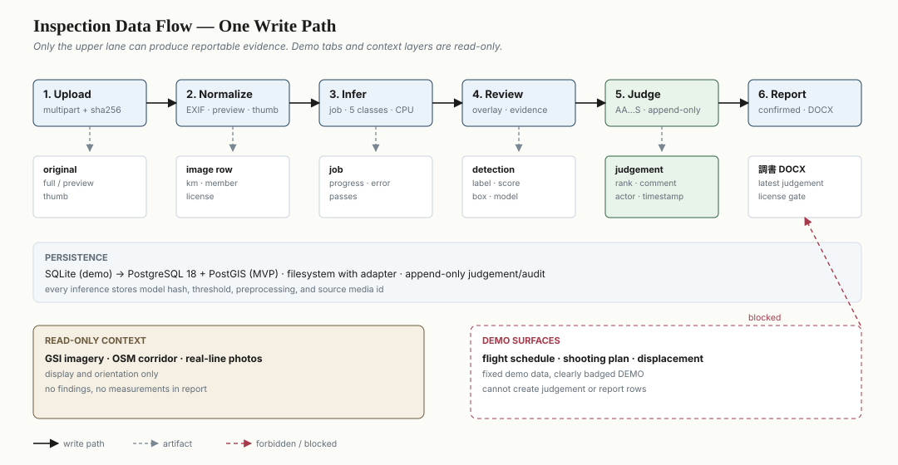

# Data — mô hình, nguồn, vòng đời

Cập nhật: 2026-11-23. Nguồn sự thật runtime: `data/demo.db` (SQLite) + filesystem dưới `data/`. Tài liệu này mô tả schema hiện tại, nguồn seed, quy ước toạ độ, license và các trường sẽ thêm cho geometry/point cloud.



## 1. Bảng

### `structure`

| Cột | Kiểu | Ý nghĩa |
|---|---|---|
| `id` | TEXT PK | ID nội bộ (`B14`, `T07`, `S1`) |
| `code` | TEXT UNIQUE | Mã hiển thị (`B-14`) |
| `name` | TEXT | `B-14 橋梁` |
| `kind` | TEXT | `bridge` / `tunnel` / `earth` |
| `km_start`, `km_end` | REAL | Dải lý trình |

### `member`

| Cột | Kiểu | Ý nghĩa |
|---|---|---|
| `id` | TEXT PK | `B14-P3` |
| `structure_id` | FK | thuộc cầu/hầm |
| `code`, `name` | TEXT | `P3`, `P3 橋脚` |
| `km_m` | REAL | lý trình đại diện |

Seed: B-14 có A1, P1–P6, A2, G1–G5; T-07 có 2 cửa hầm; 3 đoạn đất.

### `image`

| Cột | Kiểu | Ý nghĩa |
|---|---|---|
| `id` | TEXT PK | 12 hex |
| `filename` | TEXT | tên gốc |
| `stored` | TEXT | JPEG chuẩn hóa ≤6000 px |
| `preview` | TEXT | JPEG ≤2048 cho browser |
| `original` | TEXT | bytes gốc, bất biến |
| `sha256` | TEXT | hash bytes gốc |
| `width`, `height` | INT | kích thước sau chuẩn hóa |
| `km_m` | REAL NULL | lý trình; NULL = chưa gán |
| `structure_id`, `member_id` | FK NULL | vị trí nghiệp vụ |
| `license` | TEXT | `client` / `cc-by` / `cc0` / `pd` / `demo` / `unknown` |
| `attribution` | TEXT | credit cho ảnh tham chiếu/CC |
| `source` | TEXT | `demo` / `reference` / `upload` |
| `created_at` | TEXT | UTC ISO |

Quy tắc: ảnh `license=unknown` không được xuất 調書 trừ khi force có chủ đích; UI cảnh báo.

### `detection`

| Cột | Kiểu | Ý nghĩa |
|---|---|---|
| `id` | INT PK | |
| `image_id` | FK | |
| `label` | TEXT | `crack`, `spalling`, `rust`, `water leakage`, `exposed rebar` |
| `score` | REAL | raw zero-shot score, chưa calibration |
| `box_json` | TEXT | `[x1,y1,x2,y2]` chuẩn hóa 0–1 trên ảnh `stored` |
| `model` | TEXT | model id/version |
| `created_at` | UTC | |

### `judgement`

| Cột | Kiểu | Ý nghĩa |
|---|---|---|
| `id` | INT PK | |
| `detection_id` | FK | |
| `rank` | TEXT | `AA/A1/A2/B/C/S` |
| `comment` | TEXT | |
| `actor` | TEXT | demo: `技術者` |
| `created_at` | UTC | |

Append-only: trigger chặn UPDATE/DELETE. Đổi ý = dòng mới; report lấy `MAX(id)`.

### `job`

`id`, `image_id`, `status` (`queued/running/failed/done`), `progress` (0–100), `error`, timestamps. Retry chỉ cho `failed`; chạy lại thay detection của ảnh.

### `audit`

`action` (`upload/infer/judge/edit/export/import/retry/seed`), `entity`, `entity_id`, `actor`, `detail`, `created_at`. Append-only triggers.

## 2. Filesystem

```text
data/originals/<id>.<ext>   # bytes gốc, không sửa
data/uploads/<id>.jpg       # JPEG chuẩn hóa (toạ độ box dùng ảnh này)
data/previews/<id>.jpg      # ≤2048, UI hiển thị
data/thumbs/<id>.jpg        # ≤640, list
data/demo/images/           # seed 3 ảnh + meta.csv
data/demo/extra/            # 6 ảnh defect CC + manifest (seed reference)
data/demo.db                # SQLite
```

Vòng đời: upload → ghi original → normalize → tạo preview/thumb → tạo image + job → inference → detection → judgement → report. Xóa mềm chưa có; MVP cần retention + audit.

## 3. Toạ độ và lý trình

- DB lưu `km_m` theo lý trình nội bộ demo 12.400–15.600 m.
- Ảnh/asset không lưu lon/lat; MapLibre map `km → lon/lat` bằng `frontend/src/lib/geo.ts` trên alignment OSM thật quanh 根府川.
- Đây là **mapping demo**, không phải trắc đạc. Không dùng Web Mercator để đo mét.
- View 計測 dùng điểm mô hình (A1, P1–P6, A2, đầu dầm, cửa hầm), khoảng cách geodesic + Δh mô hình; nhãn `模式値`.
- CRS tương lai: lưu EPSG:4326 + CRS đo đạc (JGD2011/平面直角) + `method` (`surveyed/interpolated/unverified`).

## 4. Nguồn dữ liệu và license

| Nguồn | Dùng cho | License | Ghi chú |
|---|---|---|---|
| CrackForest (3 ảnh seed) | zero-shot demo | phi thương mại | phải thay trước khi chiếu khách |
| Wikimedia Commons (5 ảnh tuyến) | context strip | CC0 / PD / CC BY 4.0 / CC BY-SA 4.0 | credit từng ảnh trong UI |
| GSI 地理院タイル | nền 3D | GSI terms | attribution bắt buộc |
| OpenFreeMap / OSM | building 3D | ODbL | `© OpenStreetMap contributors` |
| OSM rail extract | alignment | ODbL | `data/rail_osm.json` |
| Grounding DINO tiny | inference | Apache-2.0 | zero-shot, không fine-tune |

Không dùng: CODEBRIM/CrackForest cho train thương mại, Google Street View, ảnh JR press, SNS.

## 5. API payload chính

```json
// POST /api/judgement
{ "detection_id": 12, "rank": "A2", "comment": "幅は現地確認", "actor": "技術者" }

// PATCH /api/image/{id}
{ "member_id": "B14-P3", "license": "client", "km_m": 13262 }

// GET /api/state (rút gọn)
{ "images": [{ "id": "...", "km_m": 13262, "member_name": "P3 橋脚",
  "license": "demo", "detections": [{ "id": 12, "label": "crack", "score": 0.69,
  "box": [0,0.4,1,0.6], "judgement": { "rank": "A2", "comment": "..." } }] }],
  "counts": { "images": 3, "candidates": 9, "confirmed": 1 } }
```

## 6. Quy tắc 調書

- Chỉ judgement mới nhất của detection đã xác nhận.
- Header: 線名, 区間, 点検日, 点検者, 方法.
- Footer: số confirmed, số pending, model + license.
- 409 nếu có ảnh `license=unknown`; `force=true` chỉ dùng khi có chủ đích.
- Không xuất score như xác suất; ghi `AI score` + `参考値`.

## 7. Dữ liệu tương lai

### Geometry

```text
alignment(km, lon, lat) · gauge_mm · dem_source · spans(bridge/tunnel, km_start/end)
cross_section templates · crs · template_version
```

Output: `corridor.glb`, `qa-report.json` (hash, manifold, void %, `assumed` elements). Không ghi judgement.

### Point cloud (current synthetic)

`data/pointcloud/demo/points.bin` 365k points (x,y,z,r,g,b,member), `meta.json`, 10 views + z-buffers. Generated by `backend/scripts/build_pointcloud.py`; relative geometry, gauge 1.067 m. API pick reprojects to views. Replace directory with a real survey using the same schema; see `docs/POINTCLOUD.md`.

### Drone / point cloud (future)

```text
survey(epoch, captured_at, gcp/checkpoint, crs, calibration)
media(frame, pose, uncertainty)
reconstruction(point_cloud, orthophoto, checkpoint_metrics)
measurement(point_a, point_b, distance, delta_h, uncertainty, method)
```

Điều kiện để measurement thành số thật: ≥5 GCP + ≥3 checkpoint, point cloud metric, sai số công bố, `method=surveyed`.

## 8. Giới hạn hiện tại

- 3 ảnh seed không đại diện tuyến thật; 6 ảnh defect CC đang chờ detect/seed.
- Zero-shot score chưa calibration; box thô.
- Không có point cloud, DEM terrain, PLATEAU cho 小田原.
- SQLite single-writer; chưa auth/role; chưa retention.
- Toạ độ map là demo, không dùng đo đạc.
