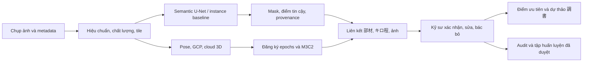

# Nghiên cứu mô hình AI cho điểm kiểm tra đường sắt

## 1. Phạm vi nghiên cứu

Bản nghiên cứu ngày 20-11-2026 dành cho MVP chạy nội bộ, một cầu bê tông, cửa hầm và mái dốc. Đầu ra là **ứng viên biến trạng (変状)**, không phải kết luận an toàn hay quyết định sửa chữa. Kỹ sư xác nhận mọi kết quả, cấp đánh giá (判定区分 AA/A1/A2/B/C/S) và ký調書. Phân loại ẩn dưới bề mặt không thể được chứng minh chỉ từ ảnh RGB. Không có phép đo hoặc benchmark nào của dự án tại thời điểm viết: mọi ngưỡng, tài nguyên và khoảng dự báo dưới đây là **[推定] / đề xuất**, không phải kết quả thực nghiệm.

Đầu vào cần nhận từ [nghiên cứu dữ liệu](01-data.md): ảnh gốc và quyền sử dụng; nhãn theo công trình/bộ phận (部材), mã hóa theo lớp và vùng bỏ qua; metadata camera, cự ly, tiêu cự, GSD thực địa, hiệu chuẩn, GCP, CRS, pose, cloud và độ bất định; liên kết epochs và số km đường sắt (キロ程). Tài liệu dữ liệu đang được biên soạn; số GSD bên dưới là **mục tiêu thiết kế được chủ tài liệu cung cấp, chưa phải đo thực tế**. Những quyết định về lưu trữ và tích hợp thuộc tài liệu kiến trúc, không ấn định thay.

### Tóm tắt điều hành và phương án khuyến nghị

| Quyết định | Đề xuất có điều kiện |
|---|---|
| Chính | U-Net/ResNet34 nhiều kênh sigmoid, `segmentation-models-pytorch` (SMP) **0.6.0**, tách crack, bong tróc, lộ thép, rỉ, ẩm/chảy nước, dấu hiệu bề mặt mái dốc; chạy tiled, xuất ONNX. Học đa nhãn vì rỉ có thể nằm trong vùng lộ thép. |
| Phụ | YOLO26s-seg để so sánh instance/bbox, **chỉ khi** đã giải quyết giấy phép Ultralytics Enterprise hoặc đáp ứng AGPL; nếu chưa, không tích hợp. Chạy cùng bộ test và điều kiện chụp. |
| Đo và thay đổi | Tính kích thước tương đối khi hiệu chuẩn/độ phân giải đạt yêu cầu; không hứa độ chính xác chiều rộng tuyệt đối cấp mm. M3C2 cho thay đổi hình học có sai số riêng từng vùng, không đồng nhất với phát triển vết nứt. |
| Báo cáo | Tạo dự thảo tiếng Nhật bằng template từ dữ liệu đã xác nhận; LLM/VLM chỉ là tùy chọn nghiên cứu ngoại tuyến, không nằm trên đường quyết định. |

SMP có mã MIT nhưng từng encoder/weights có thể khác giấy phép; v0.6.0 yêu cầu Python ≥3.10 và thay đổi cách lấy pretrained encoder qua Hugging Face, vì vậy phải đóng gói sẵn weights đã phê duyệt, không tải khi chạy [SMP release](https://github.com/qubvel-org/segmentation_models.pytorch/releases/tag/v0.6.0), [MIT license](https://github.com/qubvel-org/segmentation_models.pytorch/blob/main/LICENSE), [third-party licenses](https://github.com/qubvel-org/segmentation_models.pytorch/blob/main/licenses/LICENSES.md). Chọn encoder/weights ResNet34 với hồ sơ quyền riêng; chưa coi nguồn dữ liệu huấn luyện là được cấp quyền chỉ vì framework có MIT.

## 2. Findings

### 2.1 Formulation theo loại biến trạng

Mục tiêu bảng là **đề xuất trên test đủ điều kiện**, không phải cam kết đạt được. `R` là recall theo sự kiện; `FPI` là số false positive trên ảnh. Mẫu dữ liệu khách hàng được phân chia trước khi cắt tile; dữ liệu công khai chỉ dùng sau khi kiểm tra quyền. Bảng mô tả cách ưu tiên: ngưỡng của từng lớp, xem mục 5.5.

| Lớp | Bài toán → mô hình | Dataset cho pipeline | Chỉ tiêu PoC [推定] | Rủi ro |
|---|---|---|---|---|
| Vết nứt (ひび割れ) | Semantic segmentation U-Net; nối skeleton thành ứng viên, không dùng bbox làm số đo | Ảnh bê tông khách hàng + tập crack công khai được cấp phép, tham chiếu [OmniCrack](https://openaccess.thecvf.com/content/CVPR2024W/VAND/papers/Benz_OmniCrack30k_A_Benchmark_for_Crack_Segmentation_and_the_Reasonable_Effectiveness_CVPRW_2024_paper.pdf) | R ≥0,80; clIoU₄px báo cáo; FPI ≤1 | Vết mảnh đứt; khe nối và bóng giả; clIoU dung sai không chứng minh chính xác chiều rộng. |
| Bong tróc (剥落・剥離 bề mặt) | Semantic → connected components; YOLO26 instance để so sánh | Khách hàng; tham khảo CrSpEE trong [benchmark](https://openaccess.thecvf.com/content/CVPR2024W/VAND/papers/Benz_OmniCrack30k_A_Benchmark_for_Crack_Segmentation_and_the_Reasonable_Effectiveness_CVPRW_2024_paper.pdf), quyền riêng | R ≥0,80; mask IoU ≥0,50 trung vị; FPI ≤1 | Mảng gần nhau nhập nhầm; cạnh nhám, shadow. |
| Lộ cốt thép (鉄筋露出) | Semantic nhiều nhãn; instance khi phân tách được từng vùng | Khách hàng có xác nhận hiện trường | R ≥0,80 nếu đủ N; FPI ≤1 | Có thể đồng thời rỉ và bong; khó quan sát khi che khuất. |
| Rỉ (錆) | Semantic, không ép loại trừ thép | Khách hàng; S2DS chỉ tham khảo học thuật theo [điều khoản](https://github.com/ben-z-original/s2ds/blob/main/README.md) | R ≥0,80 nếu đủ N; FPI ≤1 | Màu biến thiên, stain không chắc là rỉ. |
| Rò/ẩm (漏水) | Semantic vùng ướt hoặc vệt, ghi rõ *dấu hiệu*, không kết luận rò đang hoạt động | Nhãn khách hàng có ngày và tình trạng thời tiết; không lấy efflorescence làm nhãn leakage | R ≥0,80 nếu đủ N; FPI ≤1 | Đổi thời tiết làm giả thay đổi; thiếu xác nhận nước thực. |
| Bóc tách lớp lót (覆工のうき・剥離) | Detection/semantic chỉ cho biểu hiện bề mặt; nhãn `suspected` | RGB + hồ sơ gõ/không phá hủy đồng vị trí nếu có | Chỉ thống kê ca có ground truth độc lập; không đặt R cho ẩn dưới bề mặt | RGB không xác nhận được rỗng ngầm; yêu cầu kiểm tra bổ sung. |
| Sạt/mất ổn định mái dốc (斜面崩壊) | Semantic vùng trượt lộ rõ + M3C2; người quyết định | Ảnh + hai cloud và khảo sát độc lập của khách hàng | R ≥0,80 nếu đủ N đối với vết trượt quan sát được; không dự báo sạt | Cây, thời tiết, hình học che phủ; không suy ra ổn định địa kỹ thuật. |

Semantic phù hợp vết nứt dài, ranh giới bất quy tắc; instance có giá trị khi cần đếm vùng bong rời. Cùng một pixel có thể mang nhiều lớp, thế nên bảy sigmoid độc lập và các mask ignore là lựa chọn an toàn hơn softmax loại trừ. Nhóm “dấu hiệu ẩn” phải giữ loại quan sát và loại kết luận riêng; không huấn luyện nhãn xác quyết từ ngoại hình đơn thuần.

### 2.2 Baseline và bằng chứng chuyển miền

[OmniCrack30k](https://openaccess.thecvf.com/content/CVPR2024W/VAND/papers/Benz_OmniCrack30k_A_Benchmark_for_Crack_Segmentation_and_the_Reasonable_Effectiveness_CVPRW_2024_paper.pdf) báo cáo trung bình clIoU với dung sai 4 px: nnU-Net 63,7%, DeepCrackZ 31,5%, CrackFormer 21,9%; các phương án dùng tập train khác nhau nên **không phải so sánh đối chứng công bằng**, cũng không phải recall trên đường sắt Nhật. Bài báo ghi nhận trùng ảnh giữa nhiều tập crack và rò rỉ split; kiểm tra trùng theo nguồn trước mọi phép đánh giá. [CrackFormer](https://openaccess.thecvf.com/content/ICCV2021/papers/Liu_CrackFormer_Transformer_Network_for_Fine-Grained_Crack_Detection_ICCV_2021_paper.pdf) và DeepCrack là baseline học thuật, xác minh mã, weights và quyền trước khi dùng. [nnU-Net](https://github.com/MIC-DKFZ/nnUNet) là phương án crack semantic mạnh để kiểm thử, nhưng tự cấu hình/ensemble và pipeline ảnh y sinh tăng công tích hợp; repo Apache-2.0, checkpoint/dữ liệu có điều khoản riêng.

[推定] Public-only trên bê tông đường sắt Nhật: recall sự kiện 0,30–0,75 và AP50 bbox 0,20–0,60 là **khoảng lập kế hoạch rất thô**, không đo, không suy ra định lượng từ clIoU: khác camera, lớp, độ rộng, ánh sáng và ngưỡng. Có thể thấp hơn cả khoảng đó. Trước tiên khóa test khách hàng, đo public-only, sau đó fine-tune trên cấu trúc khác; chỉ công bố số đo cùng N, khoảng tin cậy và định nghĩa.

[Ultralytics YOLO26](https://docs.ultralytics.com/models/yolo26/) có nhánh instance segmentation, YOLOv8 và YOLO11 là baseline cũ hơn. Trang release cho biết **ultralytics 8.4.216**, 20-11-2026; đây là phiên bản package, không phải tên model. Dùng `yolo26s-seg.pt` làm baseline phụ và chốt hash; không giả định bản mới hơn luôn tốt trên vết nứt. Ultralytics công bố AGPL-3.0 hoặc Enterprise [license](https://www.ultralytics.com/license); tư vấn pháp lý phải xác định nghĩa vụ phân phối/mạng và quyền model. Tải weights trước vào kho nội bộ. Các con số COCO trong tài liệu hãng không đại diện bê tông đường sắt.

## 3. Bảng so sánh phương án

| Option | Ưu | Nhược | Chi phí/công sức | Rủi ro |
|---|---|---|---|---|
| **U-Net SMP 0.6.0** [MIT](https://github.com/qubvel-org/segmentation_models.pytorch/blob/main/LICENSE) | Mask mảnh và đa nhãn, CPU/ONNX khả thi | Cần tự xây nhóm vùng và nối vết | [推定] thấp–trung bình; 1 pipeline chính | License encoder/weights riêng; cần benchmark thực tế. |
| **YOLO26s-seg** [model](https://docs.ultralytics.com/models/yolo26/) | Instance, ví dụ export, SAHI | Mask mỏng và seam cần kiểm tra; AGPL/Enterprise | [推定] trung bình + chi phí license nếu Enterprise | Không mặc định được dùng thương mại đóng nguồn. |
| [RT-DETR](https://github.com/lyuwenyu/RT-DETR) Apache-2.0 | Baseline detection box, cục bộ | Bản gốc không cung cấp mask pixel cho phép đo | [推定] trung bình | Check weights, không thay semantic. |
| [Mask R-CNN / Detectron2](https://github.com/facebookresearch/detectron2) Apache-2.0 | Instance masks, baseline thành thục | Hai giai đoạn, xử lý crack mảnh/seam không mặc nhiên tốt | [推定] trung–cao | Check weights, môi trường CPU/export. |
| DeepCrack / CrackFormer / [nnU-Net](https://github.com/MIC-DKFZ/nnUNet) | Chuyên crack / benchmark semantic | Khác dữ liệu, tích hợp và bản quyền cần xét | [推定] trung–cao | So sánh không cùng tập train; không chuyển kết quả nguyên xi. |
| [SAM 2.1](https://github.com/facebookresearch/sam2), [Grounding DINO](https://github.com/IDEA-Research/GroundingDINO) | Prompt box/text rồi gợi ý mask; code SAM2 và checkpoints Apache-2.0 theo repo | Con người phải sửa, đặc biệt crack mảnh; text grounding không chứng minh loại | [推定] trung bình, GPU ưu tiên | Xác minh weights Grounding DINO và phụ thuộc; không dùng nhãn tự động chưa duyệt làm ground truth. |
| [YOLO-World](https://github.com/AILab-CVC/YOLO-World) | Gợi ý open vocabulary | Không đảm bảo nhận biến trạng ngoài phân phối | [推定] trung bình; GPL-3.0 hoặc hỏi giấy phép thương mại | Không mặc định tương thích sản phẩm đóng. |
| [PatchCore / PaDiM / EfficientAD](https://anomalib.readthedocs.io/en/stable/markdown/guides/reference/models/image/) | Phát hiện khác thường chưa có lớp; anomalib mã Apache-2.0 | Cần tập bình thường theo bề mặt; anomaly không đồng nghĩa defect; PatchCore tốn bộ nhớ, PaDiM nhạy vị trí, EfficientAD thêm teacher | [推定] trung–cao | Kiểm tra weights; [license teacher EfficientAD chưa rõ](https://github.com/open-edge-platform/anomalib/issues/3710). Không gắn nhãn AA hay phủ định an toàn từ anomaly. |

## 4. Khuyến nghị

Đóng băng SMP 0.6.0, model U-Net ResNet34, 7 kênh quan sát (crack, spalling, exposed_rebar, rust, leakage, lining_suspected, slope) và 1 mask ignore theo lớp; dùng trọng số khởi tạo có quyền rõ ràng hoặc train từ đầu nếu không có. Chọn threshold từng lớp trên validation; đóng băng preprocessing, threshold và model trước test. Dự trữ YOLO26s-seg `ultralytics==8.4.216` cho phép so sánh nếu license được duyệt; không đưa vào runtime nếu chưa có phép. Với class thiếu ví dụ, giao diện vẫn cho người thêm/sửa finding, nhưng không hiển thị điểm số model giả; chức năng AI lớp đó ghi **chưa được huấn luyện/đánh giá**.

On-prem: đóng gói wheel, checkpoint, license, ảnh container và checksum bằng quy trình nhập đã duyệt; vô hiệu tải trọng số tự động, telemetry/egress và CDN. Tách job nặng GPU khỏi UI; queue và chạy CPU khi không có GPU. Mọi số về GPU, CPU, latency là [推定] cần đo trên máy khách. [ONNX Runtime](https://onnxruntime.ai/docs/execution-providers/) hỗ trợ CPU, CUDA và TensorRT execution providers, nhưng từng graph/operator phải kiểm chứng thực tế.

## 5. Đặc tả MVP

### 5.1 Interface và provenance

| Đối tượng | Trường bắt buộc / quy tắc |
|---|---|
| Capture | `capture_id`, `structure_id`, `member_id`, `epoch_id`, `image_sha256`, pixel gốc, thời gian, camera, calibration_id, GSD cục bộ nếu có, pose, CRS/đơn vị, chất lượng, thời tiết; giữ bản gốc. |
| Label | `image_id`, lớp, polygon/RLE mask ở tọa độ gốc, lớp phủ chồng, `ignore_mask`, `annotator_id`, `adjudicator_id`, version, nguồn/điều khoản; gán nhóm structure trước tiling. |
| Finding | `finding_id`, image/epoch/member, lớp quan sát, mask/box, tọa độ 3D có covariance hoặc null, キロ程 và nguồn mapping, `raw_score`, `calibrated_score` nếu có, model hash, dataset version, inference config, evidence IDs, trạng thái review. Score không tồn tại khi người nhập thủ công. |
| Comparison | epoch trước/sau, transform và phương pháp, residual theo điểm kiểm tra, coverage/visibility, giá trị thay đổi, đơn vị, error band và cách tính, phương pháp đo, confidence/quality, `insufficient_evidence` khi cần. |
| Audit | sự kiện bất biến: finding ID, người, thời gian, trước/sau, thao tác xác nhận/sửa/bác bỏ, lý do; báo cáo tham chiếu version đã ký, không ghi đè lịch sử. |

Tọa độ 2D luôn quy về ảnh gốc; 3D chỉ có khi pose, mesh/cloud, CRS và phép chiếu hợp lệ, giữ visibility/độ không chắc; sai số không biết thì null, không đặt 0. Quy tắc tính priority dựa trên 判定区分 đã được kỹ sư xác nhận và quy trình khách hàng, không tự suy ra AA/A1 từ điểm AI.

### 5.2 Chuẩn bị dữ liệu và huấn luyện

| Bước | Thiết lập ban đầu [推定], cần điều chỉnh bằng validation |
|---|---|
| Kiểm kê | Thu tối thiểu 3 công trình để split độc lập nếu được; một cầu demo không đủ đại diện. Gộp ảnh cùng cấu trúc, mọi epoch, video liên tiếp và crop vào cùng split. Kiểm tra SHA/perceptual duplicate giữa các nguồn. |
| Lượng nhãn | Mục tiêu 200–500 **ảnh gốc dương tính độc lập/lớp** crack, bong, rỉ; 100–300 lộ thép/ẩm; 50–100 dấu hiệu mái dốc nếu có. 300–500 ảnh âm đa dạng, có thể chung các lớp; số ảnh không phải số sự kiện độc lập. Không tạo nhãn delamination ẩn từ RGB. Số này là kế hoạch, không chứng minh đủ khả năng tổng quát hóa. |
| Kiểm nhãn | Hai người đánh dấu độc lập ít nhất 20% mỗi lớp và toàn bộ test khó; phân xử bất đồng, đánh dấu không nhìn thấy/không chắc bằng ignore, ghi version hướng dẫn, mặt phẳng và kích thước tham chiếu. |
| Active learning | Dùng SAM 2.1 prompt và sửa từng mask, sau đó chọn các ca score gần ngưỡng, phân bố camera/độ sáng khác, FP/FN; sampling đa dạng và ảnh ngẫu nhiên, không chỉ chọn ca model thấy. |
| Train | Cắt 1024×1024 native, overlap 20%; crop dương và âm theo tỷ lệ 1:1, loss BCE-with-logits + soft Dice từng lớp, mask ignore; ImageNet khởi tạo nếu có license, freeze encoder 5 epochs rồi mở; AdamW lr 0,0001, batch 4, tối đa 80 epochs, early-stop patience 12 theo validation crack clIoU + recall. Ghi seed và ba lần chạy nếu đủ thời gian. |
| Augment | Lật, xoay 90°, biến thiên sáng/màu nhỏ, blur và noise thực tế; giữ ảnh gốc, mask nearest-neighbor. Không crop hoặc resize làm biến mất vết nhỏ mà vẫn tính âm; không tạo vết giả để báo hiệu suất thật. Kiểm tra ảnh mưa/ẩm và bóng riêng. |
| Tài nguyên | [推定] RTX 4090 24 GB: 2–8 giờ cho một lần train U-Net với khoảng 5.000–15.000 tile/epoch, chưa tính labeling và tối ưu; thực tế phụ thuộc I/O, batch, kiến trúc và epochs. Dự trù 3–5 lần chạy, 6–40 GPU-giờ. |
| CPU | Dùng cùng checkpoint và ONNX FP32, batch 1, xử lý hàng đợi ảnh; train CPU chỉ để tinh chỉnh nhỏ hoặc offline dài [推定] 3–10 lần thời gian GPU, không hứa kịp. Khi chưa train xong, vẫn xem ảnh gốc và nhập kết quả thủ công, không mạo nhận AI. |

**Máy phát triển và demo ngày 26/11:** Windows 11, Python 3.13, Node 22, Docker 29, ffmpeg 8, không có CUDA GPU; không giả định TensorRT/4090 có sẵn. Model đã train phải đóng gói cùng ONNX Runtime CPU, checkpoint và dependencies sẵn để chạy local, xử lý trước ảnh demo nếu cần nhưng giữ provenance và cho phép chạy lại. Cấu hình Windows/Python 3.13 phải khóa wheel tương thích thực tế; chưa kiểm thử tương thích nên không tuyên bố đã hoạt động. Linux on-prem vẫn là đích triển khai. Không có GPU local thì không nhận thời gian GPU là thời gian thực tế của máy này.

**GPU thuê tối thiểu đề xuất [推定]:** một RTX A5000 24 GB, batch 2–4 và FP16; giảm batch nếu thiếu bộ nhớ. [Bảng giá Runpod](https://www.runpod.io/pricing) cập nhật 12-11-2026 niêm yết A5000 24 GB $0,27/giờ và 4090 $0,89/giờ; giá và availability thay đổi. Dự toán A5000 4–16 giờ/lần, 3–5 lần tức 12–80 giờ, **$3,24–21,60 compute [推定]**, chưa gồm storage, CPU, truyền dữ liệu, thời gian chờ, thuế hoặc retry; phải xác nhận báo giá. Đây là cấu hình nhỏ nhất được đề xuất, không khẳng định 16 GB không thể chạy hay giá được bảo đảm. Nếu không đáp ứng, dùng batch 1 hoặc thuê 4090 24 GB; kết quả cần benchmark riêng.

**Ranh giới dữ liệu:** GPU cloud công cộng không phù hợp dữ liệu nhà đường sắt không được rời mạng. Chỉ dùng dịch vụ thuê cho dữ liệu công khai có quyền hoặc dữ liệu đã được chủ sở hữu cho phép xuất rõ ràng; không coi ẩn danh là tự động đủ phép. Fine-tune trên ảnh khách hàng chỉ thực hiện trên GPU thuê/remote **nằm trong mạng và vùng kiểm soát được phê duyệt**, hoặc chạy CPU tại chỗ. Demo dùng remote GPU công cộng sẽ xung đột yêu cầu offline/on-prem và không phải phương án mặc định; GPU remote trong mạng nội bộ vẫn cần kết nối LAN và phê duyệt an ninh. Nếu cả hai không có, chạy CPU local; không xuất ảnh, metadata hay nhãn ra ngoài.

Con số tile là số lượng sau crop, không được tính như nhãn độc lập. Nguồn [S2DS](https://github.com/ben-z-original/s2ds/blob/main/README.md) nêu hạn chế academic-only và không phân phối lại: không đưa vào model thương mại nếu chưa được cấp quyền. [OmniCrack](https://openaccess.thecvf.com/content/CVPR2024W/VAND/papers/Benz_OmniCrack30k_A_Benchmark_for_Crack_Segmentation_and_the_Reasonable_Effectiveness_CVPRW_2024_paper.pdf) tổng hợp nhiều tập với quyền từng nguồn, không suy ra giấy phép chung. Dataset chủ đạo phải là ảnh khách hàng được cấp quyền; tập thiếu lớp được bổ sung sau khi có đồng thuận.

### 5.3 Ảnh 45 MP, video và deployment

[SAHI](https://github.com/obss/sahi) hỗ trợ sliced detection/instance và MIT; với semantic dùng tiler tương đương theo cùng sơ đồ. Giữ tỉ lệ ảnh, không ép toàn ảnh 45 MP về 640 px. Với ảnh ví dụ 8192×5504, tile 1024, overlap 20% ~205 px, stride 819: `ceil((8192-1024)/819)+1 = 10` cột và `ceil((5504-1024)/819)+1 = 7` hàng, **70 tile**; xử lý tile cuối dịch về biên và tránh tile trùng. 4K 3840×2160 cho 5×3 = **15 tile**. Pad nếu ảnh nhỏ hơn tile. Ghép logits semantic bằng trọng số giảm ở rìa, normalize theo coverage rồi threshold; instance đổi tọa độ về gốc, mask-aware merge/NMS, không nối hai vết chỉ vì bbox giao nhau. Test seam, crop biên, valid mask và đối tượng lớn; xử lý thêm toàn khung scale thấp khi cần bối cảnh.

| Giả định [推定], chưa benchmark | 45 MP / 70 tile | 4K / 15 tile |
|---|---|---|
| GPU 4090 24 GB, batch 4 FP16, hai model không đồng thời | 5–25 giây/ảnh, peak 4–12 GB VRAM | 1–6 giây/frame, peak 4–12 GB |
| CPU x86 16 core, 32–64 GB RAM, ONNX FP32 batch 1 | 60–300 giây/ảnh | 12–70 giây/frame |

Máy Windows thực tế chưa biết số nhân CPU và RAM: hàng CPU là phép ngoại suy cho máy 16 core/32–64 GB, **không phải phép đo trên máy demo**. Với máy hiện tại, đo 30 mẫu như dưới đây trước buổi họp; nếu quá lâu, chạy job CPU trước và trình bày kết quả thật kèm thời gian xử lý, vẫn có nút chạy lại. Không suy ra video real-time từ xử lý keyframe.

Đây là khoảng dự toán **bao gồm decode, tile, inference, merge**, không phải benchmark nhà sản xuất hay cam kết FPS. 4K không real-time; lấy keyframe và báo sampling/coverage, không bỏ qua frame mà vẫn khẳng định đã kiểm tra toàn bộ. Tính thời gian thực bằng p50/p95 sau warm-up trên ít nhất 30 ảnh, ghi GPU/CPU/RAM/VRAM, batch, precision và thời gian từng bước. Sử dụng checkpoint → ONNX có input size cố định → ONNX Runtime CPU và TensorRT FP16 có GPU; kiểm tra output và mặt nạ so với PyTorch trên validation, kể cả seam và ngưỡng; xuất không đạt thì dùng PyTorch/CPU, không tự tuyên bố tương đương. TensorRT engine gắn với môi trường GPU, cần tái build nội bộ; luôn giữ ONNX CPU.

### 5.4 GSD, chiều rộng/chiều dài và thay đổi đa epoch

Theo giao diện dữ liệu đang biên soạn, mục tiêu [推定] cho vết 0,2 mm là GSD ≤0,1 mm/px để có ~2 px phục vụ phát hiện ứng viên, và ≤0,04 mm/px để có ~5 px phục vụ **nghiên cứu đo**, không đảm bảo. Ví dụ pixel pitch 0,004 mm, f = 20 mm, H = 0,5 m → 0,1 mm/px; H = 0,2 m → 0,04 mm/px theo xấp xỉ GSD = H·p/f với mặt phẳng gần vuông góc [Pix4D](https://support.pix4d.com/hc/en-us/articles/202559809). Cự ly gần có thể không an toàn hoặc ngoài khoảng lấy nét; dùng camera cầm tay/tele phù hợp sau khi xác nhận an toàn và minimum focus. Bản chụp 45 MP không tự đảm bảo GSD này; đo GSD cục bộ theo pose và bề mặt.

Lấy mask đã duyệt, skeleton và chiều dài đường tâm trong hệ mặt phẳng/mesh, bề rộng từ khoảng cách hai biên theo pháp tuyến cục bộ, chỉ tại vị trí đủ sắc nét, độ nghiêng và độ phủ; xuất phân bố/đoạn thay vì chỉ max. Thực tế bị ảnh hưởng blur, ánh sáng, răng cưa, point-spread, lỗi biên mask, méo ống kính, cự ly, góc chụp, sai số GCP/mesh và che khuất. 2–5 px là **quy tắc thiết kế [推定]**, không đủ chứng minh khả năng đo; thí nghiệm lặp với crack gauge hoặc thước chuẩn độc lập nhiều width/camera/góc rồi báo bias, MAE và khoảng bao phủ. [Nghiên cứu đo vết nứt ảnh](https://pmc.ncbi.nlm.nih.gov/articles/PMC6111740/) cung cấp bối cảnh, không xác nhận độ chính xác hệ này. Không hứa “đo chiều rộng tuyệt đối chính xác tới 1 mm hay tốt hơn” hoặc hứa mọi vết 0,2 mm được phát hiện. Không tính số đo khi thiếu hiệu chuẩn; UI ghi `không đủ độ phân giải/độ tin cậy`.

| Đăng ký / diff | Khi dùng và giới hạn |
|---|---|
| SIFT/ORB + matching + RANSAC homography | Mặt gần phẳng, đủ texture; biến đổi 2D không thể mô tả đồng thời mặt cầu 3D với parallax. [OpenCV tutorial](https://github.com/opencv/opencv/blob/4.x/doc/tutorials/features/feature_homography/feature_homography.markdown). |
| [LoFTR](https://github.com/zju3dv/LoFTR) | Bổ sung khi texture yếu; code Apache-2.0, kiểm tra weights. Vẫn cần RANSAC và validation, không tự giải quyết parallax. |
| Pose + MVS reprojection | Khi có cloud/mesh và camera hiệu chuẩn; reprojection theo bề mặt, xử lý occlusion và điểm không có tương ứng. Ground control độc lập, không dùng vùng biến trạng để khớp. |
| [CloudCompare M3C2](https://www.cloudcompare.org/doc/wiki/index.php/PluginM3C2) | Khoảng cách có dấu theo normal, theo scale và core point; chọn normal/projection scale, minimum neighbors; vùng không tương ứng NaN là không biết. M3C2-PM khi có precision map XYZ đáng tin cậy. |

Đăng ký ổn định bằng GCP/đặc trưng vùng không đổi, kiểm tra bằng điểm **độc lập** phân bố khắp công trình, ghi residual và RMS, bias, coverage; từ chối biến đổi khi residual vượt ngưỡng được thống nhất trước. M3C2 xuất distance uncertainty/significance, nhập registration error cùng đơn vị, lưu tham số, local normal và số điểm. Giá trị này là ngưỡng phát hiện chênh lệch cục bộ, không tự động là sai số đo chiều rộng. Dùng output của phiên bản M3C2 đã khóa, không tự dựng công thức khác mà gọi là M3C2. Kiểm tra control ổn định và khảo sát độc lập vì điểm lân cận có tương quan và sai số hệ thống có thể không được mô hình hóa.

UI hiển thị d ± LoD95 theo từng vị trí cùng đơn vị, coverage và phương pháp; **±15 mm chỉ là ví dụ [推定], không dùng mặc định**. Ví dụ d=+25 mm, LoD95=15 mm: vượt ngưỡng hình học nếu các giả định và kiểm định đạt; không tự kết luận nguy hiểm. Với so sánh crack, tính biến thiên chiều dài/diện tích hoặc width chỉ trên ảnh đã đăng ký, đủ độ phân giải; tính uncertainty của chính đại lượng đó bằng đo lặp, sai số đăng ký/biên và hiệu chuẩn; không thay bằng LoD cloud.

Phân loại có điều kiện: `新規` khi ảnh cũ thực sự nhìn thấy, đủ độ phân giải và negative đã xác nhận, ảnh mới positive; `拡大` khi đại lượng cùng loại tăng vượt uncertainty và ngưỡng thực hành khách hàng, mặt nạ trùng vật thể; `変化なし` chỉ khi đủ năng lực phát hiện **và** khoảng bất định của biến thiên nằm trọn trong biên tương đương đã thỏa thuận; `判定不能` nếu không đủ thông tin hoặc khoảng giao biên. Với mẫu ít, cung cấp từng cặp, raw measurements và độ tin cậy chứ không suy ra tỷ lệ toàn mạng; mỗi nhãn vẫn chờ kỹ sư xác nhận.

### 5.5 Giao thức đánh giá có thể trình khách hàng

Tham chiếu [catalog MLIT cầu/hầm tháng 3-2026](https://www.mlit.go.jp/road/sisaku/inspection-support/zenbun.html) và [phương pháp thử chuẩn](https://www.mlit.go.jp/road/sisaku/inspection-support/pdf/27.pdf): lập bảng điều kiện chụp, loại hư hỏng, kích thước, giới hạn, ground truth, phương pháp và kết quả theo cấu trúc. Đây là **điều chỉnh theo tinh thần catalog**, không tuyên bố được chứng nhận MLIT hay tương đương bài thử đường bộ cho đường sắt.

| Hạng mục | Quy trình và tiêu chuẩn đề xuất [推定] |
|---|---|
| Split | Lý tưởng: ≥5 công trình độc lập, train ≥3, val 1, test 1; giữ mọi epoch của cùng công trình trong một split. Test gồm đủ cầu/cửa hầm/mái dốc nếu có riêng từng loại, không trộn frame cùng bề mặt. Công trình demo một cầu + một hầm + một dốc không cho phép vừa train vừa chứng minh tổng quát từng loại: dùng nguồn công trình khác hoặc ghi “đánh giá exploratory trên bộ phận giữ lại”, không gọi độc lập công trình. |
| Cỡ test | Mục tiêu ≥100 sự kiện dương tính độc lập và ≥100 ảnh âm mỗi lớp ưu tiên, từ ≥3 công trình test nếu muốn phát biểu đa công trình; đây là mục tiêu thu thập, không được tạo bằng crop/video. Nếu chưa có, báo N thực, ca hiếm chỉ mô tả, ghi N=0 là không đánh giá được. Định nghĩa một sự kiện là một biến trạng do kỹ sư phân định và gộp các ảnh/epochs cùng thực thể. |
| Ground truth | Hai kỹ sư độc lập và phân xử; bản đồ vùng quan sát được, class, loại bề mặt, kích thước tham chiếu; không dùng dự đoán model để xác định tập âm. Tách không quan sát được; dùng kiểm tra vật lý/NDT cho ground truth lớp ẩn. |
| Match | Đồng nhất class và cùng sự kiện; đối với vùng, IoU mask ≥0,5; vết nứt dài dùng overlap centerline trong ±4 px ảnh gốc và ≥50% chiều dài GT, 1-1 matching. Đóng băng quy tắc; báo thêm phép đo ở dung sai vật lý vì GSD thay đổi. Một sự kiện bị chia nhiều mask không được cộng nhiều TP. |
| Chỉ số | Recall 検出率 = TP/(TP+FN), precision 適合率 = TP/(TP+FP); FN 見落とし = số sự kiện bỏ sót và theo kích thước/lớp; FP/ảnh = FP chia **tất cả ảnh đã đánh giá** (báo riêng trên ảnh âm); AP50 và AP50:95 cho instance; mask IoU, clIoU₄px cho crack. Báo micro/macro, số ảnh và sự kiện, theo 部材, ánh sáng, GSD, thời tiết. |
| Ngưỡng | Lớp crack và bong: recall ≥0,80, precision ≥0,70, FP ≤1/ảnh ở threshold đã khóa; các lớp khác chỉ áp dụng khi đủ ≥100 sự kiện và coverage; IoU median ≥0,50 cho bong. Đây là **mục tiêu thảo luận**, không tuyên bố kết quả; an toàn vẫn cần kỹ sư xem đầy đủ ảnh. Đo thời gian/kỹ sư và số ảnh không đủ chất lượng. |
| Bất định | Báo Wilson 95% cho tỷ lệ đếm sự kiện và bootstrap theo **công trình** khi đủ cấu trúc; không coi tile/khung liền nhau là độc lập. 80/100 recall có Wilson 95% xấp xỉ 71–87% theo công thức Wilson; phụ thuộc sự độc lập, cụm làm khoảng rộng hơn. Không suy ra đạt recall ≥80% ở quần thể chỉ từ 80/100; muốn cận dưới ≥80% cần thêm mẫu/kết quả cao hơn. |
| Calibration | Chọn threshold trên validation, đánh giá reliability diagram/Brier/ECE trên test có N đủ, theo lớp và nhóm; hiệu chỉnh temperature/isotonic chỉ fit validation, không dùng test. Semantic pixel có tương quan: kiểm tra theo sự kiện, không coi triệu pixel độc lập. Khi quá ít dữ liệu ghi raw score, không gọi là xác suất chuẩn hóa. |
| Acceptance | Báo mọi mục đạt/chưa đạt/không đủ N; không loại FN khó khỏi test. Nếu không đủ dữ liệu, demo là khả thi kỹ thuật chứ không phải xác nhận năng lực triển khai. Đánh giá sau review tách riêng AI-only và human+AI, không so sánh không có baseline người. |

### 5.6 Dự thảo báo cáo và vòng đời

Xuất template tiếng Nhật từ finding đã kỹ sư xác nhận, ảnh, 部材, キロ程, 判定区分 do người nhập, thời gian, sai số và provenance; trường chưa có để trống có nhãn `未確認`, không bịa khuyến nghị hoặc số liệu. Bản draft có version, người sửa, chữ ký; xuất bản chỉ sau review. Quy tắc priority do khách hàng phê duyệt, không dùng score AI làm severity.

Tùy chọn thí nghiệm nội bộ: [Qwen3-VL](https://github.com/QwenLM/Qwen3-VL) có các checkpoint 2B/4B/8B, kế tiếp Qwen2.5-VL, mã repo Apache-2.0; kiểm tra license từng checkpoint và đánh giá tiếng Nhật trên mẫu 調書, không suy ra chất lượng từ benchmark chung. [Qwen2.5-VL](https://github.com/QwenLM/Qwen2.5-VL) là đối chứng; [Llama 3.3](https://www.llama.com/llama3_3/license/) có license cộng đồng riêng, không xem là Apache. Không khẳng định model này mới nhất mọi họ VLM. Không đưa ảnh vào LLM khi chỉ cần render từ structured findings. Nếu thử LLM: chỉ JSON allowlist ID đã duyệt, output schema/enum và numeric equality, map câu về finding ID, chặn câu không nguồn; deterministic template fallback, log model/hash/prompt; người duyệt từng câu. Schema checks không bảo đảm không ảo giác. Không gửi dữ liệu ngoài mạng.

[DVC](https://dvc.org/doc/start) có local remote: version manifest, mask, ảnh, split, dataset hash; quyền thư mục, backup và retention theo chính sách khách hàng. DVC metadata không thay thế audit bất biến. [OSS MLflow registry](https://mlflow.org/docs/latest/ml/model-registry/) lưu run, weights, mã/commit, seed, split, license, calibration, metric, config, version và alias; triển khai nội bộ và backup backend/artifacts. Registry alias chỉ đổi sau người chịu trách nhiệm duyệt, lưu lịch sử promotion và rollback, không tự train từ feedback chưa adjudicate. Không cần lakeFS cho một máy: [lakeFS](https://docs.lakefs.io/) có nhánh/version cho object storage nhưng thêm hạ tầng.

Theo từng đợt quay, theo dõi phân bố GSD, blur, ánh sáng, camera/部材, score, tỷ lệ candidate/ảnh và tỷ lệ người bác bỏ/sửa, coverage/NaN đăng ký; lấy mẫu ảnh ngẫu nhiên kể cả không candidate để tìm FN. So sánh với baseline được version hóa, cảnh báo thay đổi lớn theo ngưỡng do khách hàng duyệt; drift score không phải accuracy. Định kỳ gán nhãn lại, kiểm thử trên cấu trúc chưa dùng, duyệt model mới rồi mới promote; lưu model cũ để rollback.

## 6. Rủi ro và giảm thiểu

| Rủi ro | Giảm thiểu |
|---|---|
| Miền Nhật, bóng, ẩm khác public | Hold-out theo công trình, kiểm FN theo GSD/điều kiện; tái huấn luyện có xác nhận. |
| Quá ít sự kiện | Công bố N/CI, trạng thái không đủ mẫu; không báo đạt production. |
| Che khuất, vị trí 3D sai | Coverage/visibility, residual độc lập, `判定不能`; không biến NaN thành 0. |
| RGB không thấy bóc tách ngầm | Chỉ gọi dấu hiệu nghi ngờ, gắn yêu cầu NDT/kiểm tra trực tiếp. |
| Tile seam, nhầm mask, calibration | Kiểm test ảnh gốc, seam; export parity; lưu threshold/model hash. |
| License hoặc mạng ngoài | Duyệt từng data/weight; bundle offline và kiểm soát egress. |
| Người hiểu AI là kết luận | Luôn hiện confidence/provenance, audit, duyệt thủ công; không gán rank tự động. |

## 7. Câu hỏi cho khách hàng

1. Có thể cung cấp bao nhiêu công trình độc lập, lịch sử epoch và ảnh âm, quyền dùng huấn luyện và dữ liệu NDT đối chứng?
2. Quy định của đơn vị về 判定区分, độ rộng quan tâm, bề mặt được nhìn thấy và trường bắt buộc của 点検調書 là gì?
3. Chấp nhận mục tiêu recall/precision/FP nào cho từng loại, giới hạn bỏ sót nào cần human review toàn bộ?
4. Có ảnh cận với GSD đo được, crack gauge, GCP/checkpoints độc lập và phép chụp lặp trong điều kiện an toàn không?
5. Epoch cũ có cùng mặt nhìn, calibration, cloud và hồ sơ thời tiết để phân biệt 新規 với không nhìn thấy không?
6. Ai phê duyệt license, điểm ưu tiên, trạng thái review, thời gian giữ dữ liệu và cho phép triển khai GPU/CPU?

## 8. References & Web Sources

Các nguồn chính, dùng đúng bối cảnh và không coi benchmark nguồn ngoài là kết quả dự án:

- [MLIT: catalog cầu/hầm 2026](https://www.mlit.go.jp/road/sisaku/inspection-support/zenbun.html) và [標準試験方法](https://www.mlit.go.jp/road/sisaku/inspection-support/pdf/27.pdf): điều kiện và thử nghiệm catalog.
- [OmniCrack30k paper](https://openaccess.thecvf.com/content/CVPR2024W/VAND/papers/Benz_OmniCrack30k_A_Benchmark_for_Crack_Segmentation_and_the_Reasonable_Effectiveness_CVPRW_2024_paper.pdf): so sánh crack, trùng lặp và clIoU; [CrackFormer paper](https://openaccess.thecvf.com/content/ICCV2021/papers/Liu_CrackFormer_Transformer_Network_for_Fine-Grained_Crack_Detection_ICCV_2021_paper.pdf): mô hình chuyên biệt.
- [SMP v0.6.0](https://github.com/qubvel-org/segmentation_models.pytorch/releases/tag/v0.6.0), [SMP license](https://github.com/qubvel-org/segmentation_models.pytorch/blob/main/LICENSE), [SMP third-party licenses](https://github.com/qubvel-org/segmentation_models.pytorch/blob/main/licenses/LICENSES.md), [nnU-Net](https://github.com/MIC-DKFZ/nnUNet): triển khai segmentation và quyền.
- [Ultralytics release 8.4.216](https://github.com/ultralytics/ultralytics/releases/tag/v8.4.216), [YOLO26](https://docs.ultralytics.com/models/yolo26/), [license](https://www.ultralytics.com/license), [RT-DETR](https://github.com/lyuwenyu/RT-DETR), [Detectron2](https://github.com/facebookresearch/detectron2): baseline detection/instance.
- [SAM2](https://github.com/facebookresearch/sam2), [Grounding DINO](https://github.com/IDEA-Research/GroundingDINO), [YOLO-World](https://github.com/AILab-CVC/YOLO-World): gợi ý annotation và quyền.
- [Anomalib](https://anomalib.readthedocs.io/en/stable/markdown/guides/reference/models/image/), [EfficientAD weights issue](https://github.com/open-edge-platform/anomalib/issues/3710): anomaly và giới hạn quyền.
- [S2DS terms](https://github.com/ben-z-original/s2ds/blob/main/README.md): chỉ dùng theo quyền dữ liệu.
- [SAHI](https://github.com/obss/sahi), [ONNX Runtime providers](https://onnxruntime.ai/docs/execution-providers/): slicing và backend chạy offline.
- [Pix4D GSD](https://support.pix4d.com/hc/en-us/articles/202559809), [crack imaging research](https://pmc.ncbi.nlm.nih.gov/articles/PMC6111740/): công thức và rủi ro đo ảnh.
- [OpenCV homography tutorial source](https://github.com/opencv/opencv/blob/4.x/doc/tutorials/features/feature_homography/feature_homography.markdown), [LoFTR](https://github.com/zju3dv/LoFTR), [CloudCompare M3C2](https://www.cloudcompare.org/doc/wiki/index.php/PluginM3C2): đăng ký và sai số thay đổi.
- [Qwen3-VL](https://github.com/QwenLM/Qwen3-VL), [Qwen2.5-VL](https://github.com/QwenLM/Qwen2.5-VL), [Llama 3.3 license](https://www.llama.com/llama3_3/license/): tùy chọn tạo văn bản và điều khoản.
- [DVC](https://dvc.org/doc/start), [MLflow OSS Model Registry](https://mlflow.org/docs/latest/ml/model-registry/), [lakeFS](https://docs.lakefs.io/): versioning và lifecycle nội bộ.
- [Runpod GPU pricing](https://www.runpod.io/pricing): đơn giá công khai làm ví dụ dự toán thuê GPU; không cho phép đưa dữ liệu khách hàng ra ngoài.
