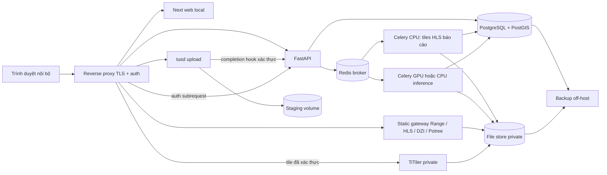

# 03 — Kiến trúc MVP kiểm tra đường sắt

## 1. Phạm vi nghiên cứu

Đề xuất cho một cầu bê tông gồm trụ, dầm, mố; một cửa hầm; một mái dốc. Ứng dụng tiếng Nhật chạy trên một máy Linux trong mạng nội bộ, không CDN, không gọi dịch vụ internet lúc chạy. Bản HTML hiện tại là nguồn tham chiếu tương tác, không phải nguồn dữ liệu hay tiêu chuẩn vận hành: các số, ngưỡng thời tiết, điểm 3D và đồ thị trong đó là ví dụ. Tài liệu này là **thiết kế đề xuất**, không xác nhận dữ liệu, mô hình, độ chính xác hay hiệu năng đã tồn tại. Ngày kiểm tra nguồn: 20-11-2026.

**Tóm tắt điều hành:** chọn Next.js/React + TypeScript ở client; FastAPI/Python cho API và worker; PostgreSQL/PostGIS làm nguồn sự thật; file store nội bộ với các đối tượng bất biến; Celery/Redis cho tác vụ nền; Potree, OpenSeadragon, TiTiler và HLS cho dữ liệu nặng. Mọi đề xuất AI/biến vị chỉ là hỗ trợ, có nguồn gốc và độ tin cậy hoặc lý do không thể định lượng; kỹ thuật viên (技術者) xác nhận riêng. Lịch bay là kế hoạch tham khảo, không cấp phép hoặc thay thế phê duyệt hiện trường.

## 2. Findings

### 2.1 Phiên bản và ràng buộc

| Thành phần | Stable đã kiểm tra | Quyết định |
|---|---|---|
| Next.js / React | [Next 16.4.6](https://github.com/vercel/next.js/releases/tag/v16.4.6), [React 19.3.1](https://github.com/react/react/releases/tag/v19.3.1) | Khóa bộ phiên bản tương thích sau khi kiểm tra tích hợp; không dùng canary. |
| FastAPI / Celery | [FastAPI 0.165.0](https://github.com/fastapi/fastapi/releases/tag/0.165.0), [Celery 5.7.0](https://github.com/celery/celery/releases/tag/v5.7.0) | Python 3.13, Pydantic 2; worker riêng API. |
| PostgreSQL / PostGIS | [PostgreSQL 19.0 và 18.7](https://www.postgresql.org/); [PostGIS 3.7.0](https://postgis.net/2026/10/PostGIS-3.7.0/) | Chọn 18.7 + 3.7.0: 19.0 vừa phát hành, tránh đổi major sát demo; kiểm tra image/build thực tế. PostGIS 3.7 hỗ trợ PostgreSQL 14–19. |
| Ảnh / điểm / raster | [OpenSeadragon 6.1.1](https://openseadragon.github.io/), [Potree 1.8.2](https://github.com/potree/potree/releases/tag/1.8.2), [Converter 2.1.5](https://github.com/potree/PotreeConverter/releases/tag/2.1.5), [TiTiler 2.4.1](https://github.com/developmentseed/titiler/releases/tag/2.4.1) | Khóa viewer và converter, kiểm tra tương thích tập tin đầu ra trước khi phát hành; không giả định mọi commit viewer tương thích. |
| Object store | [MinIO CE](https://github.com/minio/minio) hiện ghi repo không còn duy trì, phân phối source-only; binary cũ không cập nhật | Không lấy `minio/minio:latest` làm nền production. MVP dùng filesystem private sau adapter; nếu bắt buộc S3, đánh giá AIStor hoặc giải pháp được hỗ trợ, giấy phép/offline trước triển khai. |

Khóa cả dependency bắc cầu, binary và image theo digest sau kiểm thử. Các phiên bản còn lại như Redis, FFmpeg, tusd, GDAL, libvips, hls.js, LibreOffice và base image phải được chọn từ release chính thức, kiểm tra tương thích, SBOM và khóa digest trong manifest phát hành; **chưa xác minh chính xác stable của chúng**, không tự gán số phiên bản. React/Next hỗ trợ routing và component; SvelteKit cũng giải quyết routing, nên lựa chọn React là đánh đổi hệ sinh thái viewer và khả năng tuyển dụng [推定], không phải tuyên bố benchmark ([SvelteKit](https://github.com/sveltejs/kit)).

### 2.2 Ảnh, tọa độ và điểm đám mây

Ảnh 45 MP–1 GP được tiền xử lý bằng libvips tạo Deep Zoom (DZI), ô 256 hoặc 512 px, overlap cố định, JPEG cho ảnh; original giữ nguyên checksum. Viewer chỉ tải ô cần thiết, không decode nguyên ảnh; dùng OpenSeadragon. IIIF phù hợp khi cần giao thức chia sẻ ảnh chuẩn đa hệ thống nhưng thêm image server và quyền truy cập; custom tiling vừa tốn bảo trì vừa dễ sai mức zoom. Thông số và khả năng tile tham khảo [libvips dzsave](https://www.libvips.org/API/current/method.Image.dzsave.html) và [IIIF Image API](https://iiif.io/api/image/3.0/).

Overlay lưu pixel ảnh gốc theo hệ `(0,0)` góc trên trái, x phải, y xuống, độ rộng/cao sau chuẩn hóa EXIF; lưu transform từ original và version. Polygon/box phải cùng hệ với kích thước ảnh đã chuẩn hóa, không lưu pixel màn hình. Chuyển click web → viewport → image bằng `pointFromPixel` rồi `viewportToImageCoordinates`; nhiều ảnh dùng transform của từng `TiledImage` ([OpenSeadragon tọa độ](https://openseadragon.github.io/examples/viewport-coordinates/)). Overlay canvas/SVG đồng bộ zoom, hit-test theo ảnh, chỉ render trong viewport; chọn candidate đồng bộ danh sách, strip và 3D. Mục tiêu [推定] tương tác mượt trên máy khách 16 GB RAM, tile cache giới hạn và đo FPS/độ trễ thực tế; không có cam kết 1 GP trên mọi máy.

LAS/LAZ đã có thật → PotreeConverter → metadata, hierarchy và octree; viewer Potree tải LOD theo phạm vi và point budget, không tải toàn bộ ([PotreeConverter](https://github.com/potree/PotreeConverter), [Potree](https://github.com/potree/potree)). API file phải hỗ trợ HTTP Range và chuyển tiếp `206`/`Content-Range`; kiểm tra định dạng viewer/converter bằng dữ liệu thật. Đặt point budget ban đầu [推定] 1–2 triệu, hạ khi GPU yếu; RAM/GPU dùng còn phụ thuộc thuộc tính điểm, cache và trình duyệt. Không cấp phát mảng toàn bộ tập điểm. WebGL lỗi thì hiển thị danh sách/strip/ảnh và cảnh báo, không thay bằng 3D giả.

COG georeferenced lưu riêng; TiTiler nội bộ cung cấp `/cog/tiles/{tileMatrixSetId}/{z}/{x}/{y}` ([API](https://developmentseed.org/titiler/endpoints/cog/)). UI bản đồ 2D dùng tile matrix tương ứng, không coi tile địa lý là DZI: phép chiếu và trục khác nhau. Không mở TiTiler `url=` tùy ý: API xác thực `media_id`, ánh xạ đường dẫn cho phép, chặn URL ngoài/SSRF. CesiumJS chỉ thêm khi cần bối cảnh địa cầu/đa vùng đã có CRS và dữ liệu địa hình cục bộ; mặc định không dùng cloud hoặc globe ([CesiumJS](https://github.com/CesiumGS/cesium)).

Mỗi tập có CRS ngang, datum cao độ, đơn vị, epoch, biến đổi và sai số đăng ký; tọa độ local 3D khác pixel ảnh và khác キロ程. Chỉ liên kết 3D ↔ ảnh khi có pose/calibration đã kiểm chứng; thiếu thì hiện 「位置未確定」, không nội suy chính xác giả. Đường ray đo thật và đoạn nội suy đánh dấu riêng; không dùng nội suy làm quan trắc. So sánh hai kỳ yêu cầu kiểm tra GCP/điểm độc lập và mật độ phủ; lưu phương pháp, sai số/độ tin cậy, đơn vị, mặt nạ thiếu dữ liệu, và dải sai số. Thiếu căn chỉnh, sai số hoặc kỳ trước thì trạng thái `unavailable`, không vẽ ±15 mm mặc định; không dùng ước tính ảnh để kết luận sai lệch mm của đường ray.

### 2.3 Video, phát và upload

Worker dùng FFmpeg tạo HLS VOD fragmented MP4: playlist, init segment, media segments, thumbnail/index; giữ file gốc và checksum. Thiết lập GOP kín theo thời gian segment và FPS, không mặc định số frame cho mọi video. Browser dùng hls.js nếu hỗ trợ Media Source Extensions, Safari dùng HLS native theo feature detection ([FFmpeg HLS](https://ffmpeg.org/ffmpeg-formats.html#hls-2), [hls.js](https://github.com/video-dev/hls.js)). Reverse proxy xác thực cả playlist, segment, byte range; không trả URL public. Timeline lưu presentation timestamp (PTS), timebase và frame index khi có; video variable-frame-rate không quy đổi `time × FPS` để khẳng định frame. Click finding seek PTS; click frame tạo finding với PTS + ảnh frame trích từ original, hash và transform. Encoding, trích xuất đều là job có provenance.

Upload dùng tus 1.0: tạo resource, `HEAD` lấy offset, `PATCH` nối tiếp; offset sai trả 409; file chưa hoàn thành không xuất hiện như media hợp lệ ([tus](https://tus.io/protocols/resumable-upload)). Check quota, quyền, kích thước, sha256 server-side; ghi staging volume, hoàn thành mới atomically publish và ghi DB; dọn upload hết hạn có kiểm soát. Kết nối gián đoạn có thể tiếp tục sau khi xác thực lại.

## 3. Bảng so sánh phương án

| Option | Ưu | Nhược | Chi phí/công sức | Rủi ro |
|---|---|---|---|---|
| Next/React + TS | UI phong phú, tích hợp viewer; cùng ngôn ngữ frontend | Framework lớn, phải khóa bảo mật server | [推定] thấp nếu nhóm biết React | Sai tương thích dependency ([Next](https://github.com/vercel/next.js/releases/tag/v16.4.6)). |
| SvelteKit | Ít boilerplate, giao diện reactive | Tích hợp viewer và kinh nghiệm nhóm cần xác nhận | [推定] tương đương nếu nhóm đã biết | Chuyển stack ảnh hưởng tiến độ ([SvelteKit](https://github.com/sveltejs/kit)). |
| FastAPI vs Node API | Python dùng trực tiếp pipeline AI, schema/OpenAPI | API không chạy inference inline; cần hai hệ JS/Python | [推定] thấp hơn tích hợp AI qua Node | Worker crash không được làm mất job ([FastAPI](https://fastapi.tiangolo.com/)). |
| PostGIS + filesystem vs MinIO CE | Một máy, đơn giản backup; không cần S3 | Phải xây adapter, kiểm soát quyền và backup file | [推定] thấp; S3 đổi sau | MinIO CE không duy trì; cần review license nếu dùng ([MinIO](https://github.com/minio/minio)). |
| Celery vs RQ / arq / Temporal | Hàng đợi Python riêng CPU/GPU, retry/routing | Redis + vận hành worker | [推定] trung bình | Chạy lặp phải idempotent; [RQ](https://python-rq.org/), [arq](https://github.com/python-arq/arq) đơn giản hơn; [Temporal](https://docs.temporal.io/) mạnh workflow nhưng thêm hạ tầng. |
| DZI/OSD vs IIIF vs custom | Tiền tạo ô, viewer trưởng thành | Tăng dung lượng và thời gian ingest | [推定] thấp–trung bình | Không benchmark trên thiết bị khách; IIIF hữu ích khi cần interoperability ([IIIF](https://iiif.io/api/image/3.0/)). |
| Potree vs Three.js loader tự viết | Octree/LOD có sẵn | Tích hợp version và bảo trì viewer | [推定] thấp hơn tự làm | Sai CRS/Range gây lỗi; custom loader phải tự viết LOD ([Potree](https://github.com/potree/potree)). |

## 4. Khuyến nghị

Chọn các phiên bản trong §2.1, vendor cả source/binary và font tiếng Nhật được phép phân phối, pin image digest sau khi xác thực. Backend tách `api`, `worker-cpu`, `worker-gpu`; nếu không có GPU, cùng chức năng inference chạy trên worker CPU với cấu hình/model được nhóm mô hình xác nhận, hiển thị tiến trình lâu hơn, không trả kết quả giả. Tại bất kỳ thời điểm chỉ một nhóm worker nhận queue inference: GPU **hoặc** CPU; worker CPU vẫn xử lý media. Điểm giao với nhóm dữ liệu/mô hình: `media_id`, checksum, kích thước, transform, `model_id/version/hash`, preprocess, bbox/polygon pixel gốc, confidence/calibration, class, thời gian và link output; quyền dùng model/dataset và CPU runtime phải xác nhận trước khi đóng gói.

Tính khả thi [推定]: 12 tuần × 1–2 người là 12–24 person-week, không tính dữ liệu/đào tạo mô hình và phê duyệt vận hành bên khách. Các mục dưới đây chồng lấn khi có hai người; tổng ~19–28 person-week [推定], vì vậy 1 người không thể cam kết toàn scope 12 tuần. Đường găng là dữ liệu thật, độ phủ epoch và tích hợp mô hình; thiếu đầu vào phải hiển thị không sẵn sàng chứ không thay bằng dữ liệu giả.

| Thành phần | Person-week [推定] | Đầu ra |
|---|---:|---|
| Khung app, auth, API, DB, audit | 3–4 | Tài khoản + ghi vết xuyên luồng |
| Upload, DZI, HLS, viewer | 3–4 | Ảnh/video thực + overlay |
| Potree, COG, CRS, strip | 3–4 | Liên kết vị trí có nguồn gốc |
| Mô hình/worker + xác nhận | 2–4 | Đề xuất thật, CPU fallback |
| Lịch, kế hoạch, thời tiết | 2–3 | Ràng buộc cấu hình, lịch bền vững |
| So sánh kỳ và sai số | 2–3 | Dữ liệu thật hoặc báo thiếu |
| Ưu tiên, DOCX/PDF, triển khai/backup | 4–6 | Báo cáo nháp và phục hồi |

## 5. Đặc tả MVP

### 5.1 Triển khai và luồng dữ liệu



Luồng: upload → kiểm hash và commit media → outbox job DB → worker tạo sản phẩm vào thư mục tạm → publish bất biến → ghi kết quả/provenance → UI chọn ứng viên → kỹ thuật viên xác nhận → ưu tiên và báo cáo nháp. Proxy xác thực mỗi request qua API rồi gateway đọc thẳng volume `store` read-only để stream DZI, HLS và Potree; TiTiler đọc COG từ cùng volume, không tải file qua API. API chỉ cấp quyền và ánh xạ media ID sang key nội bộ, không expose đường dẫn POSIX ra browser. Không expose DB, Redis, TiTiler, file store hoặc tusd trực tiếp; chặn path traversal và symlink ra ngoài gốc.

### 5.2 DDL phác thảo

PostgreSQL/PostGIS; UUID do ứng dụng sinh. Để ngắn, `created_at`, `created_by`, `updated_at`, `version integer not null default 1`, `deleted_at`, `deleted_by` áp dụng cho bảng mutable registry/event/media/task/flight/report; tất cả FK tới người dùng. Soft delete chỉ ẩn khỏi danh sách mặc định, không xóa audit/judgement/media đang tham chiếu. SQL dưới là sơ đồ khởi đầu, migration phải thêm các cột chung này, index, constraint và trigger nêu sau; không chạy nguyên khối như migration hoàn chỉnh.

```sql
CREATE EXTENSION IF NOT EXISTS postgis;
CREATE TABLE app_user (id uuid PRIMARY KEY, username text UNIQUE NOT NULL,
  password_hash text NOT NULL, role text NOT NULL CHECK (role IN ('engineer','pilot','admin')),
  disabled_at timestamptz);
CREATE TABLE line (id uuid PRIMARY KEY, code text UNIQUE NOT NULL, name text NOT NULL,
  crs text NOT NULL, vertical_datum text, geometry geometry(LineStringZ));
CREATE TABLE asset (id uuid PRIMARY KEY, line_id uuid NOT NULL REFERENCES line,
  code text NOT NULL, kind text NOT NULL CHECK(kind IN ('bridge','tunnel_portal','slope')),
  km_start_m numeric NOT NULL, km_end_m numeric NOT NULL CHECK(km_end_m >= km_start_m),
  geom geometry, UNIQUE(line_id,code));
CREATE TABLE member (id uuid PRIMARY KEY, asset_id uuid NOT NULL REFERENCES asset,
  parent_id uuid REFERENCES member, code text NOT NULL, kind text NOT NULL,
  geom geometry, UNIQUE(asset_id,code));
CREATE TABLE inspection (id uuid PRIMARY KEY, asset_id uuid NOT NULL REFERENCES asset,
  observed_at timestamptz NOT NULL, previous_id uuid REFERENCES inspection,
  registration jsonb, status text NOT NULL);
CREATE TABLE media (id uuid PRIMARY KEY, inspection_id uuid NOT NULL REFERENCES inspection,
  kind text NOT NULL, object_key text NOT NULL UNIQUE, sha256 char(64) NOT NULL,
  bytes bigint NOT NULL CHECK(bytes >= 0), width integer, height integer,
  crs text, vertical_datum text, transform jsonb, captured_at timestamptz,
  parent_media_id uuid REFERENCES media, metadata jsonb NOT NULL DEFAULT '{}');
CREATE TABLE finding (id uuid PRIMARY KEY, inspection_id uuid NOT NULL REFERENCES inspection,
  member_id uuid REFERENCES member, media_id uuid REFERENCES media,
  km_m numeric, point3d geometry(PointZ), image_geometry jsonb, pts_ms bigint,
  previous_finding_id uuid REFERENCES finding,
  change_kind text CHECK(change_kind IN ('expanded','new','unchanged','unknown')),
  state text NOT NULL CHECK(state IN ('open','confirmed','rejected','reshoot')));
CREATE TABLE suggestion (id uuid PRIMARY KEY, finding_id uuid NOT NULL REFERENCES finding,
  job_id uuid NOT NULL, model_id text NOT NULL, model_version text NOT NULL,
  model_sha256 char(64) NOT NULL, input_sha256 char(64) NOT NULL,
  preprocess jsonb NOT NULL, output jsonb NOT NULL,
  confidence double precision CHECK(confidence BETWEEN 0 AND 1),
  confidence_note text, created_at timestamptz NOT NULL DEFAULT now(),
  CHECK(confidence IS NOT NULL OR confidence_note IS NOT NULL));
CREATE TABLE judgement (id uuid PRIMARY KEY, finding_id uuid NOT NULL REFERENCES finding,
  suggestion_id uuid REFERENCES suggestion, supersedes_id uuid REFERENCES judgement,
  author_id uuid NOT NULL REFERENCES app_user, outcome text NOT NULL,
  severity text CHECK(severity IN ('AA','A1','A2','B','C','S')),
  change_kind text CHECK(change_kind IN ('expanded','new','unchanged','unknown')),
  reason text NOT NULL, created_at timestamptz NOT NULL DEFAULT now());
CREATE TABLE possession_window (id uuid PRIMARY KEY, line_id uuid NOT NULL REFERENCES line,
  starts_at timestamptz NOT NULL, ends_at timestamptz NOT NULL CHECK(ends_at > starts_at),
  km_start_m numeric NOT NULL, km_end_m numeric NOT NULL, source text NOT NULL);
CREATE TABLE weather_observation (id uuid PRIMARY KEY, starts_at timestamptz NOT NULL,
  ends_at timestamptz NOT NULL, wind_ms numeric, rain_mm numeric,
  observed_at timestamptz NOT NULL, source text NOT NULL, source_version text,
  CHECK(ends_at > starts_at));
CREATE TABLE flight (id uuid PRIMARY KEY, asset_id uuid NOT NULL REFERENCES asset,
  possession_id uuid REFERENCES possession_window, weather_id uuid REFERENCES weather_observation,
  starts_at timestamptz, ends_at timestamptz, status text NOT NULL,
  route jsonb, rules_version text NOT NULL, decision jsonb);
CREATE TABLE reshoot_task (id uuid PRIMARY KEY, finding_id uuid REFERENCES finding,
  flight_id uuid REFERENCES flight, reason text NOT NULL, status text NOT NULL);
CREATE TABLE shooting_step (id uuid PRIMARY KEY, flight_id uuid NOT NULL REFERENCES flight,
  member_id uuid REFERENCES member, kind text NOT NULL, start_offset_s integer NOT NULL,
  duration_s integer NOT NULL CHECK(duration_s > 0), sequence integer NOT NULL);
CREATE TABLE analysis_run (id uuid PRIMARY KEY, previous_inspection_id uuid NOT NULL REFERENCES inspection,
  current_inspection_id uuid NOT NULL REFERENCES inspection, job_id uuid NOT NULL,
  method text NOT NULL, params jsonb NOT NULL, registration jsonb NOT NULL,
  uncertainty jsonb, coverage jsonb NOT NULL, results_media_id uuid REFERENCES media,
  status text NOT NULL);
CREATE TABLE job (id uuid PRIMARY KEY, kind text NOT NULL,
  state text NOT NULL CHECK(state IN ('queued','running','failed','done')),
  progress numeric CHECK(progress BETWEEN 0 AND 1), attempt integer NOT NULL DEFAULT 0,
  input jsonb NOT NULL, output jsonb, error jsonb, lease_until timestamptz,
  created_at timestamptz NOT NULL DEFAULT now(), updated_at timestamptz NOT NULL DEFAULT now());
CREATE TABLE report (id uuid PRIMARY KEY, inspection_id uuid NOT NULL REFERENCES inspection,
  status text NOT NULL, snapshot jsonb NOT NULL, template_version text NOT NULL,
  docx_media_id uuid REFERENCES media, pdf_media_id uuid REFERENCES media);
CREATE TABLE audit_log (id bigint GENERATED ALWAYS AS IDENTITY PRIMARY KEY,
  at timestamptz NOT NULL DEFAULT now(), actor_id uuid REFERENCES app_user,
  request_id uuid NOT NULL, action text NOT NULL, entity text NOT NULL,
  entity_id uuid NOT NULL, before_data jsonb, after_data jsonb, reason text);
```

`previous_id` phải cùng asset và thời gian trước; `previous_finding_id` phải thuộc inspection trước, cùng member hoặc có quyết định mapping của kỹ thuật viên. `new` không tự suy ra chỉ vì không match; đánh dấu unknown khi coverage thiếu. `expanded` dựa trên phép đo có đơn vị/sai số và chứng cứ, không chỉ so nhãn AI; `unchanged` cũng cần bằng chứng so sánh. Judgement là append-only: thu hồi quyền UPDATE/DELETE cho app role, trigger từ chối thay đổi; hiệu chỉnh bằng dòng mới trỏ `supersedes_id` cùng finding, kiểm tra vòng lặp và khóa finding trong transaction. Trạng thái hiện tại suy ra judgement mới nhất theo chuỗi, không overwrite; cùng transaction insert audit. Owner DB vẫn có quyền đặc biệt nên backup và bản sao audit off-host bảo vệ khỏi quản trị viên sửa trực tiếp.

`job_id` của suggestion/analysis thêm FK sau khi tạo job; job có outbox (`id, job_id unique, published_at`) và bảng idempotency (`actor_id, route, key, request_hash, response, expires_at`, unique actor/route/key). Dùng optimistic locking `version`/`If-Match`; conflict 409/412. Audit mọi login thất bại/thành công, thay quyền, upload, xét duyệt, sửa lịch, export, xóa mềm, chạy lại job; không log mật khẩu, token hoặc nội dung ảnh. Giới hạn role DB; `audit_log` append-only, retention theo khách hàng. Index `(line_id,km_start_m,km_end_m)`, `(inspection_id,state)`, `(finding_id,created_at)`, `(state,updated_at)` và GiST geom; giao diện xem audit chỉ admin.

### 5.3 API, job và lỗi

Tất cả route `/api/v1`, JSON UTF-8, thời gian RFC 3339 UTC, UI trình bày Asia/Tokyo; phân trang `limit,cursor`. Quyền server kiểm tra từng tài nguyên; không tin role client. `Idempotency-Key` cho tạo upload, job, judgement, task, report và phân lịch; cùng key + cùng hash trả response đầu, khác body trả 409. TTL tối thiểu [推定] 7 ngày và giữ tới khi job kết thúc. Trong một transaction tạo job + outbox, dispatcher publish Redis; worker claim row có lease, heartbeat, attempt và conditional update. Queue có thể giao lại: sản phẩm ghi vào prefix attempt, publish atomically theo job/idempotency key; không hứa exactly-once. Worker chết → lease hết hạn → đánh dấu failed hoặc retry có giới hạn; `GET /jobs/{id}` trả `{id,state,progress,stage,attempt,error,output}`; progress `null` nếu không biết, UI polling [推定] 2 giây. Retry tạo attempt, không xóa lịch sử. Redis không phải nguồn sự thật.

| Endpoint | Mục đích |
|---|---|
| `POST /auth/login`, `POST /auth/logout`, `GET /me` | Session cookie HttpOnly/Secure/SameSite; CSRF token cho ghi. |
| `GET /lines`, `/assets?line_id=&km_from=&km_to=`, `/assets/{id}/members` | Registry, strip; CRUD admin qua POST/PATCH tương ứng. |
| `GET /inspections?asset_id=`, `POST /inspections`, `GET /inspections/{id}` | Kỳ kiểm tra và kỳ trước. |
| `POST /uploads`, `HEAD/PATCH /uploads/{id}`, `POST /uploads/{id}/complete` | tus creation/core qua tusd; complete idempotent kiểm checksum và tạo media. |
| `GET /media/{id}`, `/media/{id}/content`, `/media/{id}/dzi/{path}`, `/media/{id}/hls/{path}`, `/media/{id}/potree/{path}`, `/media/{id}/ortho/tiles/{z}/{x}/{y}` | Metadata, dữ liệu có auth, Range; gateway map ID sang đường dẫn hợp lệ. |
| `POST /jobs`, `GET /jobs/{id}`, `POST /jobs/{id}/retry` | Tạo xử lý `tile/transcode/convert/infer/compare/export`, theo dõi và retry có quyền. |
| `GET /inspections/{id}/findings`, `POST /findings`, `GET /findings/{id}` | Danh sách/bộ lọc; tạo finding thủ công hoặc từ analysis. |
| `GET /findings/{id}/suggestions`, `POST /findings/{id}/judgements`, `GET /findings/{id}/judgements` | Đề xuất bất biến và lịch sử xác nhận. |
| `POST /reshoot-tasks`, `PATCH /reshoot-tasks/{id}`, `GET /reshoot-tasks` | Yêu cầu chụp lại, gắn flight. |
| `GET/POST /possessions`, `GET/POST /weather`, `GET/POST /flights`, `PATCH /flights/{id}` | Nhập dữ liệu thật đã duyệt; lập và cập nhật chuyến bay. |
| `POST /flight-plans/preview`, `POST /flight-plans/commit`, `GET /flights/{id}/shooting-plan`, `PUT /flights/{id}/shooting-plan` | Preview giải thích ràng buộc; commit transactional theo version; lưu Gantt. |
| `POST /analyses`, `GET /analyses/{id}`, `GET /analyses/{id}/series`, `POST /analyses/{id}/findings` | Hai kỳ, đường biểu diễn + uncertainty + coverage, tạo candidate không lặp. |
| `GET /priorities?inspection_id=`, `POST /reports`, `GET /reports/{id}`, `POST /reports/{id}/export` | Thứ tự có giải thích, snapshot judgement đã xác nhận, job DOCX/PDF. |
| `GET /audit?entity=&entity_id=` | Admin xem lịch sử có phân trang. |

Lỗi chuẩn ví dụ `{"error":{"code":"POSSESSION_CONFLICT","message":"線路閉鎖時間外です","details":{},"request_id":"..."}}`; 400 input sai, 401 chưa đăng nhập, 403 không đủ quyền, 404 không thấy, 409 xung đột/idempotency, 412 version cũ, 422 validation, 500 lỗi nội bộ không lộ stack. API phải trả lý do không thể bay khi thời tiết cũ/không có, ngoài khung đóng đường, vượt thời gian hoặc xung đột thiết bị. Thời tiết trong mạng cách ly do người dùng import CSV/JSON có nguồn, thời điểm ban hành/hết hạn và audit, không gọi API ngoài; ngưỡng gió/mưa và thời lượng là cấu hình do khách phê duyệt, không mặc định từ HTML. Tự động phân lịch chỉ tạo preview; người có quyền mới commit, kiểm lại dữ liệu và version trong transaction.

Báo cáo dựa snapshot ID judgement chính xác và version template; sinh DOCX qua `python-docx`, PDF từ LibreOffice headless trong worker cô lập, có font Nhật đã cài và nhúng khi xuất; kiểm glyph, page break và nội dung. Bản xuất ghi hash, tác giả, thời điểm, nhãn 下書き; không tự xác nhận báo cáo. Xem [python-docx](https://python-docx.readthedocs.io/) và [LibreOffice CLI](https://help.libreoffice.org/latest/en-US/text/shared/guide/convertfilters.html).

### 5.4 Màn hình → API

| Màn hình | Server bắt buộc | Client-only, không ghi nghiệp vụ |
|---|---|---|
| 飛行スケジュール | Flight/possession/weather/reshoot, preview/commit, route và xung đột, audit | Chọn tuần, ô lịch, highlight, zoom route. |
| 撮影計画 | Shooting-plan, thời lượng, quy tắc đóng đường, cập nhật reshoot/version | Gantt, cuộn, chọn bước; cảnh báo hiển thị từ kết quả server. |
| 点検確認 | Registry/strip/coverage, media DZI/HLS/Potree, findings/suggestion/judgement, reshoot, provenance | Pan/zoom/3D focus, chọn chip, đồng bộ highlight, fallback WebGL; ghi xác nhận phải gọi API. |
| 変位解析 | Kỳ, job analysis, series, uncertainty, mask, tạo finding và liên kết flight | Chuyển kỳ/loại đồ thị, hover và focus 3D; không tự tạo đường cong/giá trị. |
| 保守優先度 | Xếp hạng có rule version + trạng thái xác nhận, snapshot/report/export | Sort/filter hiển thị, modal preview; không tự quyết định thứ hạng chính thức. |

Ưu tiên dùng rule có version, chỉ rank judgement đã xác nhận theo cấu hình khách; đề xuất chưa xác nhận hiện riêng, không giả vờ là kết luận. `AA/A1/A2/B/C/S` là mã lưu trữ, không tự suy luận thứ tự hoặc chính sách S khi chưa được khách xác nhận. Server trả lý do, input, thời gian và nguồn cho mỗi hàng.

### 5.5 Compose, offline và vận hành

| Service/image đề xuất | Volume/quyền | Vai trò |
|---|---|---|
| `proxy`: nginx image khóa digest | cert/key và `store` read-only | Cổng TLS nội bộ, auth subrequest; static gateway stream DZI/HLS/Potree trực tiếp. |
| `web`: image build Next standalone | không volume | Gói JS/CSS/font/vendor nội bộ. |
| `api`: image Python build từ wheelhouse | cấu hình/secrets read-only, `store` theo quyền adapter | FastAPI, session, audit, outbox dispatcher; không proxy dữ liệu file. |
| `db`: image nội bộ PostgreSQL 18.7 + PostGIS 3.7.0 | `pgdata` | Cơ sở dữ liệu, migrate riêng. |
| `redis`: image khóa digest | volume Redis tùy cấu hình | Broker; DB/outbox giữ tính bền vững. |
| `upload`: tusd image khóa digest | `staging` | Upload resumable, hook vào API, không public riêng. |
| `worker-cpu`: image Python + FFmpeg/GDAL/libvips/Converter/LibreOffice | `staging`, `store`, `scratch`, model read-only | Chuyển đổi, xuất; nhận inference khi CPU-only. |
| `worker-gpu`: image CUDA + Python tương thích | `store`, `scratch`, model read-only | Profile GPU, chỉ queue inference; không chạy đồng thời worker inference CPU. |
| `titiler`: image TiTiler 2.4.1 khóa digest | cùng `store` read-only | Raster tiles, TiTiler đọc COG trực tiếp qua mount; chỉ proxy nội bộ sau xác thực. |
| `backup`: image nội bộ với rsync, PostgreSQL client | `store` read-only, off-host mount mã hóa, secrets | `pg_dump` + rsync file-level + manifest. |

GPU profile riêng, host cần driver và NVIDIA Container Toolkit. Compose cấu hình `deploy.resources.reservations.devices: [{driver: nvidia, count: 1, capabilities: [gpu]}]`; không bật profile GPU nếu thiếu thiết bị ([Docker GPU](https://docs.docker.com/compose/how-tos/gpu-support/)). Profile `cpu` chạy đầy đủ API, media và worker inference CPU; profile `gpu` thay worker inference CPU bằng GPU, còn worker media CPU luôn chạy. Chọn profile khi khởi động theo thiết bị, không khởi chạy container đòi GPU trên máy không có GPU; sau khi đổi profile phải drain job, chuyển queue và khởi động lại worker, không đổi model âm thầm. Inference bất đồng bộ, UI không block; hiển thị stage, tiến độ và ETA ước lượng từ thời gian job thực cùng loại/model/phần cứng, hoặc 「推定時間未確定」 khi chưa đủ mẫu, không bịa ETA.

**Hợp đồng storage:** duy nhất một adapter filesystem chạy thật, gồm `put(stream, checksum) -> key`, `get(key) -> stream`, `stat(key) -> {size,sha256}`, `range(key,start,end) -> stream`, `delete(key)` theo chính sách retention/quyền. Khóa logic và checksum đi qua API nội bộ; API công khai chỉ trả media ID/URL, không trả POSIX path. Original dùng `original/sha256/ab/cd/{sha256}`; derived dùng `derived/{pipeline_version}/sha256/ab/cd/{sha256}` kèm manifest liệt kê các tile/segment và quan hệ media. Ghi file tạm trên cùng filesystem, stream tính SHA-256, fsync file, atomic rename không ghi đè rồi fsync thư mục; nếu hash tồn tại kiểm nội dung/kích thước và dùng lại. Original bất biến; xóa vật lý chỉ bởi GC có quyền sau khi xác nhận không còn tham chiếu và hết retention, ghi audit. Thư mục Potree giữ `metadata.json`, `hierarchy.bin`, `octree.bin` theo manifest phiên bản; không bắt browser biết đường dẫn vật lý.

Nginx auth subrequest xác nhận quyền `media_id` và chỉ ánh xạ key đã đăng ký sang `internal` location; file video và octree phục vụ Range/HEAD/ETag từ đĩa, `206`/`Content-Range`, không nạp cả file vào RAM. COG đọc trực tiếp bởi TiTiler từ mount read-only, API ánh xạ ID sang đường dẫn nội bộ hợp lệ và không cho client truyền `url` tùy ý; tile ảnh là kết quả đọc từng phần COG, không phải trả nguyên file. File DZI nhiều ô và HLS segment cần inode đủ; giới hạn concurrency, RAM, CPU và scratch. Không cần service MinIO trong Compose.

S3 chỉ là **hợp đồng adapter tương lai**, một stub trong thiết kế, không triển khai adapter S3 thứ hai trong MVP. Sau MVP, chọn đánh giá và triển khai [SeaweedFS](https://github.com/seaweedfs/seaweedfs) on-prem với S3 khi cần nhiều node hoặc dữ liệu hữu dụng vượt 10 TB [推定] và backup/khôi phục một máy không còn đạt RPO/RTO; 10 TB là ngưỡng kích hoạt đánh giá, không phải giới hạn kỹ thuật. Migration cần triển khai adapter S3 thực, chuyển key/checksum, kiểm kê và cutover, đồng thời đổi đường đọc trực tiếp TiTiler/Potree sang endpoint tương thích đã bảo vệ. Chi phí [推定] thêm 2–4 person-week triển khai/diễn tập và vận hành master/filer/volume, capacity replication, monitoring, backup và patch; xác nhận kiến trúc/chi phí thực trước quyết định. Không yêu cầu internet runtime.

Đánh đổi đối với TiTiler/Potree: filesystem gắn với một node, không hứa adapter S3 tương thích ngay; chuyển distributed storage đòi đổi data plane và kiểm thử lại Range. [TiTiler](https://developmentseed.org/titiler/user_guide/getting_started/) đọc COG từ đường dẫn local; [PotreeConverter](https://github.com/potree/PotreeConverter) tạo octree được HTTP server phục vụ cho viewer, trong khi server đọc trực tiếp từ disk.

Gói offline: export image OCI/tar + digest, wheelhouse Python có lock/hash, npm cache hoặc bundle build sẵn, binary GDAL/FFmpeg/Converter, model weights checksum, Japanese fonts/license, CA nội bộ, migration, tài liệu và SBOM; chuyển bằng phương tiện đã kiểm duyệt. Không chạy `npm install`, tải weight hay font lúc start; vô hiệu telemetry/auto-update và network egress, kiểm tra trong môi trường air-gap. Secrets cấp tại site, không nằm trong image. Cần TLS nội bộ, NTP nội bộ, quyền file theo service, không chạy privileged.

Backup nhất quán DB + file: tạm dừng ingest/worker và ghi, đợi transaction/đối tượng publish xong; tạo manifest SHA-256, `pg_dump -Fc` cùng `pg_dumpall --globals-only`, rồi `rsync -a` file-level `store/` và dump/manifest sang checkpoint mới trên đích mã hóa off-host; kiểm exit code và checksum, sau đó mới mở ghi. Không dùng `--delete` lên bản backup duy nhất; giữ các checkpoint độc lập theo retention. Đây là một điểm nhất quán chung, không coi dump DB đơn lẻ đủ cho file. Khôi phục image/secret → roles → DB → `rsync -a` file từ cùng checkpoint vào store trống → đối chiếu toàn bộ key/hash → kiểm tra ứng dụng trước mở ghi. `pg_dump` cho snapshot nhất quán của một DB, không bao gồm global roles ([PostgreSQL backup](https://www.postgresql.org/docs/current/backup-dump.html)); [rsync manual](https://download.samba.org/pub/rsync/rsync.1) mô tả sao chép file. RPO/RTO, tần suất và diễn tập khôi phục do khách phê duyệt; single host không phải HA. Nâng cấp: backup/restore thử, đưa image và migration đã kiểm trong mạng cách ly, dừng ghi, migrate, đối chiếu; rollback binary chỉ khi schema còn tương thích, nếu không restore cặp DB/store cùng checkpoint.

Observability: JSON log `request_id, actor_id, job_id, event, duration`, xoay vòng; health/readiness riêng, metrics hàng đợi/lease/failed, đĩa/inode, DB, worker, GPU nếu có; cảnh báo qua dashboard nội bộ hoặc vận hành cục bộ. Không đưa ảnh, token, mật khẩu vào log. Sizing [推定] máy Linux triển khai 16 CPU cores, RAM 64 GB, NVMe 2 TB usable + đĩa backup riêng, GPU 24 GB tùy chọn; CPU tối thiểu thử nghiệm 8 cores/32 GB và media nhỏ, không cam kết tốc độ. Filesystem đơn node không cần RAM/CPU cho MinIO, nhưng cần tính scratch, inode và thời gian rsync. Máy client [推定] 16 GB RAM, GPU WebGL và mạng LAN; đo lại bằng ảnh lớn/point budget thực. Dung lượng phải tính original + derived + scratch + backup theo khảo sát thực, không coi 2 TB là đủ mọi dataset.

Máy demo Windows 11 hiện có Python 3.13, Node 22, Docker 29, FFmpeg 8 và không có NVIDIA GPU: dùng Compose Linux containers với profile CPU, inference chạy nền, hiển thị ETA hoặc chưa xác định; không gọi CUDA hay khởi động service GPU. Chuẩn bị model CPU, font và image trước khi offline; thời gian xử lý thực cần đo, có thể ingest trước buổi họp nhưng kết quả vẫn phải từ dữ liệu/model thật. Đường dẫn Windows chỉ cấu hình mount host; bên trong container dùng path Linux nhất quán. Dùng tên file phân biệt hoa/thường, test xung đột case, UTF-8/LF cho script, font Nhật giống image deploy; kiểm UID/GID và quyền ghi named volumes trên Windows/WSL và Linux. Không giả định quyền POSIX bind mount Windows tương đương Linux; test atomic rename trên cùng volume và đường backup/restore ở cả hai môi trường. Node/FFmpeg host không thay thế version đã khóa trong image.

### 5.6 Quyền và bảo mật

| Vai trò | Quyền |
|---|---|
| 技術者 | Xem dữ liệu, tạo candidate, xác nhận/từ chối/sửa bằng judgement mới, tạo báo cáo, yêu cầu chụp lại. |
| 撮影担当 | Xem tài sản liên quan, upload, lập/sửa lịch và shooting plan, cập nhật task; không xác nhận mức độ. |
| 管理者 | Quản trị tài khoản, cấu hình/nguồn/rule, dữ liệu, backup, xem audit; không tự động có quyền phê duyệt nghiệp vụ trừ khi được cấp rõ. |

Tài khoản cục bộ mật khẩu hash Argon2id, timeout session, khóa/rate-limit đăng nhập, cấp tài khoản cá nhân và thu hồi; audit ghi cả hành động thất bại. Phân quyền server, CSRF, bảo vệ upload, HTML escaping, không render dữ liệu nhập thành HTML. Không SSO, multi-tenant, kết nối cloud, Kubernetes, telemetry ngoài hay quyền public bucket. Phân quyền theo tài sản chỉ thêm nếu khách yêu cầu; không xem nhẹ kiểm soát mạng nội bộ. Tham khảo [OWASP password storage](https://cheatsheetseries.owasp.org/cheatsheets/Password_Storage_Cheat_Sheet.html) và [OWASP authorization](https://cheatsheetseries.owasp.org/cheatsheets/Authorization_Cheat_Sheet.html).

### 5.7 Thứ tự lát cắt dọc

| Mốc | Tiêu chí sản phẩm thực |
|---|---|
| Tuần 2 | Một asset thật + ảnh thật → resumable upload → DZI → inference model thật (CPU hoặc GPU) → chọn candidate có provenance → judgement bất biến/audit → report nháp. Có auth, lưu DB và file, không giả đầu vào. Lịch và các loại dữ liệu khác hiển thị trạng thái chưa có nếu chưa nhập; không coi đây là toàn MVP. |
| Tuần 6 | Đủ ba asset demo; LAS/LAZ Potree + CRS, strip, video HLS, thời tiết/đóng đường nhập offline, reshoot và lịch/plan có ràng buộc; đồng bộ tương tác năm view, backup/restore đầu tiên. |
| Tuần 12 | Hai epoch thật nếu được cấp, registration/uncertainty/coverage, priority theo rule khách, report DOCX/PDF Nhật, phân quyền đầy đủ, hardening offline, kiểm thử lỗi/khôi phục và nghiệm thu. Không có epoch/độ chính xác hợp lệ thì nêu rõ không thể kết luận, không tự tạo giá trị. |

## 6. Rủi ro & giảm thiểu

| Top 5 rủi ro | Giảm thiểu và điều kiện dừng |
|---|---|
| Sai CRS, epoch, sai số hoặc phủ thiếu gây kết luận biến vị sai | Kiểm độc lập GCP, lưu datum/transform/mask và uncertainty; không tính khi không đủ bằng chứng; xác minh hiện trường/検測車. |
| Mô hình kém phù hợp, thiếu provenance, CPU quá chậm | Kiểm model và giấy phép với chủ sở hữu mô hình; lưu hash, preprocessing, confidence/calibration; kỹ thuật viên xác nhận; đo CPU thật. |
| Dữ liệu/giấy phép không đến kịp hoặc 1 người thiếu công suất | Chốt dataset thật và quyền ngay tuần 1; ước lượng ở §4, không đánh đồng milestone 2 tuần với toàn scope. |
| Hỏng ổ/backup lệch DB–file, queue giao lặp | Bất biến, outbox, idempotency, checkpoint nhất quán và restore off-host; diễn tập; single host vẫn có downtime. |
| Viewer nặng, phụ thuộc cũ, MinIO ngừng duy trì hoặc lộ đường dẫn | Budget LOD, Range, benchmark thực; pin/vendoring, gateway deny-by-default, chọn store được hỗ trợ và review license. |

**Cấm đưa nguyên prototype vào sản phẩm:** three.js từ CDN và Google Fonts ngoài mạng; số đo/đồ thị/điều kiện thời tiết giả; trạng thái chỉ lưu trong browser; không có audit; kết luận AI tự động. Thay bằng thư viện và font cục bộ, dữ liệu nhập có nguồn, API/DB và judgement append-only. Không có dữ liệu thật thì ghi rõ chưa có, không dựng placeholder có vẻ là kết quả đo.

## 7. Câu hỏi cho khách hàng

1. Danh mục cầu/cửa hầm/mái dốc, bộ phận, CRS/datum, キロ程 và quyền dùng ảnh, điểm, video của từng kỳ là gì?
2. Có hai kỳ có thể căn chỉnh, GCP/điểm kiểm tra độc lập, 検測車 và phương pháp xác định dải sai số không?
3. Quy tắc 線路閉鎖, thời tiết, hiệu lực dự báo, xung đột thiết bị, phê duyệt chuyến bay và nguồn import nội bộ là gì?
4. Mẫu 点検調書, mã 判定区分 AA/A1/A2/B/C/S, thứ tự ưu tiên và tiêu chí 拡大/新規/変化なし nào có hiệu lực?
5. Vai trò có cần phân theo từng tài sản? Ai được hủy/xác nhận judgement và giữ audit bao lâu?
6. Máy chủ/client, GPU, dung lượng, mạng, hệ điều hành, CA nội bộ và cơ chế đưa gói vào air-gap được duyệt ra sao?
7. Đích backup độc lập, RPO/RTO, tần suất diễn tập khôi phục và thời gian bảo trì là bao nhiêu?
8. Tập model thực, giấy phép, runtime CPU, ngưỡng confidence/calibration và người chịu trách nhiệm kiểm định là gì?

## 8. References & Web Sources

- [Next.js 16.4.6](https://github.com/vercel/next.js/releases/tag/v16.4.6), [React 19.3.1](https://github.com/react/react/releases/tag/v19.3.1), [SvelteKit](https://github.com/sveltejs/kit): phiên bản và lựa chọn UI.
- [FastAPI 0.165.0](https://github.com/fastapi/fastapi/releases/tag/0.165.0), [Celery 5.7.0](https://github.com/celery/celery/releases/tag/v5.7.0), [RQ](https://python-rq.org/), [arq](https://github.com/python-arq/arq), [Temporal](https://docs.temporal.io/): API và hàng đợi.
- [PostgreSQL releases](https://www.postgresql.org/), [PostGIS 3.7.0](https://postgis.net/2026/10/PostGIS-3.7.0/), [PostgreSQL backup](https://www.postgresql.org/docs/current/backup-dump.html), [MinIO CE](https://github.com/minio/minio): version, spatial và backup/storage.
- [OpenSeadragon coordinates](https://openseadragon.github.io/examples/viewport-coordinates/), [libvips dzsave](https://www.libvips.org/API/current/method.Image.dzsave.html), [IIIF Image API](https://iiif.io/api/image/3.0/): tile và hệ tọa độ ảnh.
- [Potree](https://github.com/potree/potree), [Potree 1.8.2](https://github.com/potree/potree/releases/tag/1.8.2), [PotreeConverter 2.1.5](https://github.com/potree/PotreeConverter/releases/tag/2.1.5), [TiTiler 2.4.1](https://github.com/developmentseed/titiler/releases/tag/2.4.1), [TiTiler COG API](https://developmentseed.org/titiler/endpoints/cog/), [CesiumJS](https://github.com/CesiumGS/cesium): 3D và địa lý.
- [FFmpeg HLS](https://ffmpeg.org/ffmpeg-formats.html#hls-2), [hls.js](https://github.com/video-dev/hls.js), [tus 1.0](https://tus.io/protocols/resumable-upload): streaming và upload.
- [Docker Compose GPU](https://docs.docker.com/compose/how-tos/gpu-support/), [python-docx](https://python-docx.readthedocs.io/), [LibreOffice conversion](https://help.libreoffice.org/latest/en-US/text/shared/guide/convertfilters.html): vận hành và export.
- [OWASP Password Storage](https://cheatsheetseries.owasp.org/cheatsheets/Password_Storage_Cheat_Sheet.html), [OWASP Authorization](https://cheatsheetseries.owasp.org/cheatsheets/Authorization_Cheat_Sheet.html): auth và phân quyền.
- [SeaweedFS](https://github.com/seaweedfs/seaweedfs): phương án S3 on-prem sau MVP; [rsync manual](https://download.samba.org/pub/rsync/rsync.1): backup file-level; [TiTiler getting started](https://developmentseed.org/titiler/user_guide/getting_started/): đọc COG local.
