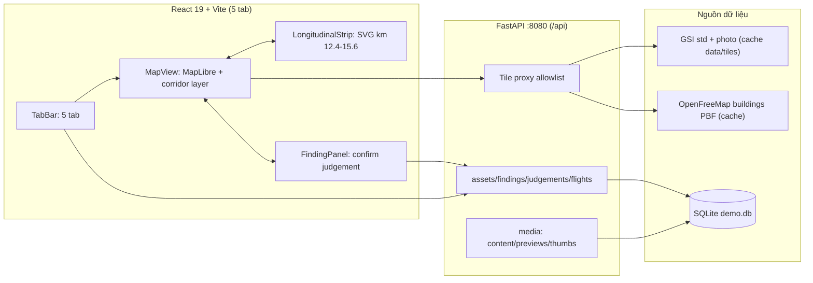

# 04b — Kiến trúc 3D viewer và tích hợp React cho demo kiểm tra đường sắt

## 1. Phạm vi nghiên cứu (Scope)

Tài liệu này trả lời đúng 8 câu hỏi được giao: so sánh 5 hướng render 3D, hệ tọa độ (座標系) Nhật Bản, nhà 3D, point cloud (点群), kiến trúc React (5 tab), tích hợp FastAPI, kế hoạch 2 ngày trước demo 26/11/2026, và rủi ro.

 Đối tượng demo là tuyến giả định với cầu B-14 (trụ P1–P6, dầm G1–G5, mố A1/A2), hầm T-07, đoạn đất đắp/cắt, lý trình km 12k400–15k600. Ngày kiểm tra nguồn: 23-11-2026. Mọi con số hiệu năng chưa đo trên thiết bị demo đều ghi `[推定]`.

- Chỉ dùng thư viện mở và dữ liệu mở/miễn phí (không license trả phí, không token trả phí trong client).
- Ưu tiên hiển thị tốt ở Nhật, chạy offline bằng dữ liệu đã cache (キャッシュ).
- Demo 26/11 chỉ cần "bản đồ 3D đáng tin": nền + ảnh + công trình + marker, không cần point cloud thật.
- Mọi khẳng định về giới hạn kỹ thuật đều có URL trong §8; số phiên bản từ tra cứu ngày 23-11, endpoint từ trang gốc đã đọc trực tiếp.

Ngoài phạm vi: AI training, photogrammetry, backend kiểm tra (xem `01-data.md`, `02-model.md`, `03-architecture.md`).

## 2. Findings

### 2.1 So sánh 5 hướng render 3D

| Tiêu chí | MapLibre GL JS + lớp Three.js tùy biến | CesiumJS + 3D Tiles | Three.js độc lập | deck.gl | Potree |
|---|---|---|---|---|---|
| Render tốt nhất | Bản đồ nền raster/vector, nhà đùn khối (fill-extrusion), hành lang tuyến (corridor), marker, mô hình cầu/hầm đặt theo tọa độ | Địa cầu (globe) thật,地形 toàn cầu, 3D Tiles đô thị (PLATEAU), bay qua nhiều tỉnh | Hành lang tuyến tùy biến, mặt cắt dọc (縦断), overlay ảnh 45 MP, mô phỏng nội bộ không cần bản đồ | Lớp dữ liệu lớn (hàng triệu điểm/marker), point cloud qua Tile3DLayer, heatmap, arc | Point cloud LAS/LAZ đã convert, octree LOD, đo đạc trong viewer |
| Nhà thành phố | `fill-extrusion` từ vector tiles (nhẹ, theo zoom) | 3D Tiles LOD1/LOD2 có texture (nặng, đẹp) | Tự dựng khối (chỉ hợp tuyến ngắn) | PolygonLayer đùn khối (cần dữ liệu tự cấp) | Không phù hợp |
| Địa hình (地形) | Có, qua `raster-dem` (Terrain-RGB) hoặc quantized-mesh + adapter | Có, Cesium Terrain / PLATEAU-Terrain | Tự nạp DEM và dựng lưới | Có, qua TerrainExtension | Nền trung tính, không phải bản đồ |
| Hành lang + point cloud | Corridor tốt; point cloud phải tự viết loader (không LOD) | Tốt cả hai qua 3D Tiles (`pnts`) | Corridor tốt nhất; point cloud nhỏ (< vài triệu điểm) mới ổn | Tốt: PointCloudLayer / Tile3DLayer | Point cloud tốt nhất; corridor phải tự thêm |
| Marker/ảnh kiểm tra | Tốt (symbol + popup, click đồng bộ tab) | Tốt (billboard/entity) | Tự code picking | Tốt (IconLayer, picking sẵn) | Yếu cho marker nghiệp vụ |
| Bundle JS [推定] | ~1.077 KB min / ~293 KB gzip cho maplibre-gl ([nguồn](https://javascriptlibraries.com/package/maplibre-gl)); + three ~725–736 KB min / ~181–190 KB gzip nếu thêm ([nguồn](https://bundlephobia.com/package/three)) | Vài MB + assets tĩnh riêng (worker, CSS, WASM); không có số duy nhất, số 3,6 MB đo năm 2022 đã lạc hậu ([nguồn](https://cesium.com/blog/2022/08/01/cesium-releases-in-august-2022/)) | three ~725–736 KB min / ~181–190 KB gzip, tree-shake được ([nguồn](https://bundlephobia.com/package/three)) | Deck + Layer chuẩn ~504,9 KB min / ~146,8 KB nén ([nguồn](https://deck.gl/docs/developer-guide/building-apps)) | Viewer độc lập, không tính bundle chung; nặng RAM theo point budget |
| GPU/RAM, mobile [推定] | Nhẹ nhất trong 5; chạy tốt trên laptop tích hợp và tablet tầm trung | Nặng nhất; globe + 3D Tiles tốn VRAM, mobile yếu dễ rớt frame | Phụ thuộc code tự viết; dễ leak nếu không dispose geometry | Trung bình-khá; WebGPU/WebGL, cần giới hạn số layer | Cần GPU rời cho đám mây > 5 triệu điểm; mobile chỉ xem vùng nhỏ |
| License | BSD-3-Clause ([nguồn](https://www.npmjs.com/package/maplibre-gl?activeTab=readme)) | Apache-2.0, dùng thương mại miễn phí ([nguồn](https://cesium.com/platform/cesiumjs)) | MIT ([nguồn](https://threejs.org/license/)) | MIT ([nguồn](https://www.npmjs.com/package/deck.gl)) | BSD-2-Clause; PotreeConverter xem license riêng ([nguồn](https://github.com/potree/potree/blob/develop/LICENSE)) |
| Tích hợp React | `react-map-gl/maplibre` v8 (entry riêng, không dùng import mặc định cũ), hỗ trợ maplibre v4/v5/v6 ([nguồn](https://visgl.github.io/react-map-gl/docs/get-started)); hoặc tự quản lifecycle trong `useEffect` + `useRef` | `resium` hoặc tự quản Viewer trong `useEffect`; Vite cần cấu hình worker/assets Cesium ([nguồn](https://cesium.com/learn/cesiumjs-learn/cesiumjs-webpack/)) | Trực tiếp qua `useRef` + `useEffect`, toàn quyền vòng đời | `@deck.gl/react` (DeckGL component), đồng bộ viewState với MapLibre qua `mapbox-overlay` ([nguồn](https://github.com/visgl/deck.gl/blob/master/docs/developer-guide/base-maps/using-with-maplibre.md)) | Nhúng iframe/div độc lập; đồng bộ state với React qua event bridge thủ công |
| Phiên bản chốt | `maplibre-gl@6.19.0` (phát hành 17-11-2026) ([nguồn](https://github.com/maplibre/maplibre-gl-js/releases)), `react-map-gl@8.1.3` ([nguồn](https://github.com/visgl/react-map-gl/releases)) | `cesium@1.147.0` (02-11-2026) ([nguồn](https://github.com/CesiumGS/cesium/releases)) | `three@0.187.0` (30-10-2026) ([nguồn](https://www.npmjs.com/package/three?activeTab=versions)) | `deck.gl@9.4.1` stable; 10.x còn alpha ([nguồn](https://www.npmjs.com/package/deck.gl?activeTab=versions)) | `potree@1.8.2` ([nguồn](https://github.com/potree/potree/releases)) |

Kết luận nhánh: MapLibre + fill-extrusion + marker là lõi demo; Three.js chỉ làm custom layer hành lang (`renderingMode: '3d'`); CesiumJS, deck.gl, Potree để sau họp ([nguồn](https://maplibre.org/maplibre-gl-js/docs/API/interfaces/CustomLayerInterface/)).

### 2.2 Hệ tọa độ (座標系): WGS84, Web Mercator, 平面直角座標系, tọa độ công trình

| Hệ | Định nghĩa | Đơn vị | Dùng ở đâu |
|---|---|---|---|
| WGS84, EPSG:4326 (世界測地系, thực tế JGD2011 ở Nhật) | Hệ địa lý: kinh/vĩ độ theo độ; thứ tự GIS thường là (kinh, vĩ) | Độ | Lưu trữ chuẩn mọi asset/marker/finding trong DB và API |
| Web Mercator, EPSG:3857 | Phép chiếu cầu cho bản đồ web, `x = R·λ`, `y = R·ln(tan(π/4+φ/2))`, `R = 6.378.137 m`, cắt vĩ ±85,0511° ([nguồn](https://proj.org/en/stable/operations/projections/webmerc.html)) | Mét | Render trong MapLibre/Cesium; GSI tiles cũng dùng công thức Mercator này, loại cực ±85,0511° ([nguồn](https://maps.gsi.go.jp/development/siyou.html)) |
| 平面直角座標系 (19 đới Gauss-Krüger) | Phép chiếu conformité, tỉ lệ trục `0,9999`, gốc `X = 0, Y = 0`; chú ý Nhật ghi `(X, Y) = (bắc, đông)` ([nguồn](https://www.gsi.go.jp/LAW/heimencho)) | Mét | Đo đạc hiện trường, nghiệm thu mm; bản đồ demo không dùng trực tiếp |
| Tọa độ công trình (local) | `(km, offset ngang, cao độ ray)` dọc tuyến; `(x, y, z)` mét tại chỗ cho trụ/dầm | Mét | Đặt trụ P1–P6, dầm G1–G5, marker biến trạng (変状) lên bản đồ |

Quy tắc mã EPSG cho JGD2011: đới I→IXX lần lượt EPSG:6669–6687; ví dụ vùng Tokyo chính là đới IX, EPSG:6677 ([nguồn](https://www.mlit.go.jp/plateau/file/libraries/doc/plateau_doc_00031_ver03.pdf)). Chọn đới theo vị trí tuyến, không đoán theo tỉnh gần nhất.

Đặt trụ/marker từ km + offset (キロ程 + 横断オフセット):

1. Tuyến có polyline chuẩn kèm `km_m` mỗi đỉnh; nội suy tâm tuyến tại km mục tiêu, dịch theo pháp tuyến một đoạn `offset` ra mép dầm/mố.
2. API trả `lon/lat` đã tính + giữ `km_m`, `offset_m`, `crs: "EPSG:4326"` để truy vết; client không tự suy tọa độ từ km.

Ghép point cloud drone không có pose tuyệt đối:

- Không gán tọa độ tuyệt đối khi thiếu pose đã kiểm chứng (nhãn「位置未確定」); cách duy nhất là đăng ký cứng với ≥5 điểm khống chế (標定点) + ≥3 điểm kiểm tra độc lập ([nguồn](https://docs.opendronemap.org/map-accuracy/)); ngưỡng gợi ý [推定] GCP ≤5 mm, residual công khai theo kỳ; thiếu GCP thì point cloud chỉ xem khung local.

Ngân sách sai số (error budget) [推定]:

| Nguồn sai số | Độ lớn điển hình | Ghi chú |
|---|---|---|
| Web Mercator ở vĩ Nhật (~35°) | Biến dạng khoảng cách ~0,5–1% nếu đo trực tiếp trên mét chiếu | Không đo mét trên bản đồ web; đo trên 平面直角座標系 hoặc local |
| Nội suy km→lon/lat | Phụ thuộc mật độ đỉnh alignment; đỉnh mỗi 10–20 m cho đoạn cong | Ghi `method: "interpolated"` khi đỉnh thưa |
| Đặt marker bằng tay trên ảnh | Vài mét nếu chỉ ước từ ảnh | Mọi marker tay gắn cờ `unverified`, không dùng cho 変位解析 |
| GSI DEM (標高タイル) | Lưới 5–10 m, sai số mét | Chỉ làm nền trực quan, không làm datum cao độ |

### 2.3 Nhà 3D: fill-extrusion từ vector tiles so với 3D Tiles (PLATEAU)

| Tiêu chí | MapLibre `fill-extrusion` | Cesium 3D Tiles (PLATEAU) |
|---|---|---|
| Nguồn dữ liệu | OpenFreeMap vector tiles (schema OpenMapTiles, có lớp `building`), style sẵn `https://tiles.openfreemap.org/styles/liberty` ([nguồn](https://openfreemap.org/quick_start/)) | Data catalog PLATEAU: `tileset.json` theo自治体, LOD, năm; có composite toàn quốc (`all-bldg-lod1-2025`…) và `-latest` ([nguồn](https://docs.plateauview.mlit.go.jp/datasets/3d-tiles/)) |
| Chất lượng | Khối hộp theo chiều cao, không texture; đủ ngữ cảnh "khu dân cư quanh tuyến" | LOD1 khối / LOD2 mái + texture; đúng chuẩn CityGML |
| Hiệu năng [推定] | Hàng chục nghìn polygon trong view vẫn mượt ở zoom 14–16; quá zoom 16 ở đô thị dày cần giới hạn `maxzoom`/lọc | LOD1 toàn quốc qua 1 composite URL; LOD2 + texture chỉ bật khi camera < 2 km, tốn VRAM gấp nhiều lần |
| Streaming | Vector tiles theo view, cache trình duyệt | 3D Tiles external tileset + HTTP cache ETag/`304` ở catalog ([nguồn](https://docs.plateauview.mlit.go.jp/datasets/3d-tiles/)) |
| License/terms | OSM ODbL: giữ ghi công `© OpenStreetMap contributors`; raster `tile.openstreetmap.org` cấm scrape/offline hàng loạt ([nguồn](https://operations.osmfoundation.org/policies/tiles/)); OpenFreeMap có terms riêng, cho offline giới hạn ([nguồn](https://openfreemap.org/)) | Mỗi自治体 một điều kiện (CC BY 4.0, 公共データ利用規約, ODC BY, ODbL…), kiểm tra từng dataset ([nguồn](https://www.mlit.go.jp/plateau/start-guide/)); dịch vụ phát là thử nghiệm, không SLA ([nguồn](https://docs.plateauview.mlit.go.jp/datasets/3d-tiles/)) |
| Fallback | Không có nhà → nền GSI + khối tuyến vẫn đủ demo; vùng quê Nhật本来 ít nhà cao tầng | Không có PLATEAU cho vùng tuyến → rỗng; mạng chậm → tileset treo màn hình globe |

Quyết định: demo dùng fill-extrusion; PLATEAU để sau họp.

### 2.4 Point cloud (点群): Potree so với 3D Tiles so với Three.js

| Tiêu chí | Potree 1.8 + PotreeConverter | Cesium 3D Tiles (`pnts`) / deck.gl Tile3DLayer | Three.js thuần (Points/PointCloudLayer đơn) |
|---|---|---|---|
| LOD | Octree có sẵn, tải theo vùng nhìn + point budget ([nguồn](https://github.com/potree/PotreeConverter)) | Duyệt tileset, render tile `pnts` bằng PointCloudLayer con ([nguồn](https://deck.gl/docs/api-reference/geo-layers/tile-3d-layer)) | Không LOD; nạp toàn bộ geometry vào GPU |
| Point budget [推定] | Khởi điểm 1–2 triệu điểm desktop, giảm khi GPU yếu | Tương đương, phụ thuộc tileset và `pointSize` | < 500 nghìn điểm cho laptop tích hợp nếu muốn 60 fps |
| Phục vụ offline | File tĩnh + bắt buộc HTTP Range (`206`/`Content-Range`); reverse proxy xác thực từng `media_id` | Cùng yêu cầu Range/CORS cho `tileset.json` + tile con | Một file/lần tải, đơn giản nhất nhưng không scale |
| Khi nào bỏ hẳn | Không có LAS/LAZ thật, không có GCP, hoặc còn < 1 ngày → bỏ, không dựng point cloud giả | Cùng điều kiện; thêm lý do mạng demo yếu | Chỉ giữ nếu point cloud mẫu < 50 MB đã có sẵn để trang trí corridor |

Quyết định: demo 26/11 **không point cloud**; thay bằng ảnh 45 MP + marker + strip 縦断.

### 2.5 Kiến trúc React: cây component, lifecycle, state, đa ngữ

Cây component đề xuất (5 tab, giữ nguyên tên Nhật trong UI):

```text
<App>                       state: lang, tabId, selectedAssetId, selectedFindingId
 ├─ <TabBar/>               5 tab: 飛行スケジュール / 撮影計画 / 点検確認 / 変位解析 / 保守優先度
 ├─ <ScheduleTab/>          lịch bay (real: FastAPI; chi tiết xung đột = mock ghi nhãn)
 ├─ <ShootingPlanTab/>      Gantt bước chụp (real: API; thanh thời gian = tính client)
 ├─ <InspectTab/>           ⭐ 3D map + 縦断 strip + panel finding/confirm
 │   ├─ <MapView/>          MapLibre instance duy nhất, custom layer corridor
 │   ├─ <LongitudinalStrip/> SVG dải km 12,4–15,6, click ↔ map bay tới
 │   └─ <FindingPanel/>     danh sách + xác nhận (judgement) gọi API thật
 ├─ <DisplacementTab/>      biểu đồ SVG theo kỳ (real khi có 2 kỳ; thiếu →「データ不足」)
 └─ <PriorityTab/>          bảng xếp hạng theo rule version server trả về
```

Quy tắc lifecycle và hiệu năng:

- Một `Map` instance duy nhất trong `MapView` (`useRef` + `useEffect` tạo một lần, `map.remove()` khi unmount); chuyển tab chỉ ẩn DOM, không destroy map.
- Không đưa `viewState` vào React state từng frame: cập nhật ref/throttle, chỉ `setState` khi đồng bộ chọn asset.
- Dữ liệu bản đồ (GeoJSON trụ/marker) vào `useMemo`, cập nhật qua `map.getSource().setData()` thay vì re-render component.
- Worker MapLibre v6 với Vite: `setWorkerUrl(workerUrl)` với `?worker&url`, import đúng entry `react-map-gl/maplibre` ([nguồn](https://visgl.github.io/react-map-gl/docs/upgrade-guide)); i18n JP/EN/VI giữ trong `frontend/src/lib/i18n.ts`, không tách hệ thứ hai.

### 2.6 Tích hợp FastAPI: proxy tiles, auth, cache, CRS metadata, chống SSRF

| Việc | FastAPI phục vụ | Static/CDN phục vụ | Ghi chú an toàn |
|---|---|---|---|
| API nghiệp vụ (`/assets`, `/findings`, `/judgements`, `/flights`, `/priorities`, `/reports`) | Có, JSON UTF-8, thời gian RFC 3339 UTC, UI hiện Asia/Tokyo | Không | Session cookie + CSRF; mọi ghi cần quyền server |
| Tile raster GSI (std/写真) | Proxy `/tiles/gsi/{layer}/{z}/{x}/{y}` kiểm tra `layer ∈ {std, seamlessphoto}` + giới hạn zoom | Không gọi trực tiếp từ browser ở bản on-prem | Chặn SSRF: allowlist host + template path, không nhận URL tự do; trả `Cache-Control: public, max-age=86400` [推定] |
| Vector tiles nhà (OpenFreeMap) | Proxy `/tiles/buildings/{z}/{x}/{y}.pbf` hoặc self-host PMTiles | Browser cache + `ETag` | Ghi công OSM + link license trong footer map |
| 3D Tiles PLATEAU (sau họp) | Chỉ proxy catalog JSON đã allowlist domain `api.plateauview.mlit.go.jp` | Tile content vẫn từ nguồn, cache qua proxy | Dịch vụ thử nghiệm, không SLA; timeout ngắn + fallback nền phẳng |
| Ảnh kiểm tra 45 MP | `/media/{id}/content`, `/previews/`, `/thumbs/` đã có trong `backend/app/api.py` | Nginx `X-Accel`/static sau auth subrequest | Giữ nguyên pipeline hiện tại; không thay đổi |
| Point cloud (sau họp) | `/media/{id}/potree/...` hỗ trợ `Range` → `206`/`Content-Range` | Nginx serve file trực tiếp sau auth | Không đọc cả file vào RAM |

CRS metadata: mọi response địa lý kèm `{ "crs": "EPSG:4326", "km_m": …, "offset_m": …, "method": "surveyed|interpolated|unverified", "updated_at": … }`; client không bao giờ đoán CRS.

Đóng gói offline: prefetch tiles demo vào `data/tiles/` kèm manifest `{layer, z, x, y, sha256, fetched_at}`; bản air-gapped mount volume này, style trỏ `/tiles/...` nội bộ, UI ghi「オフライン用キャッシュ」.

### 2.7 Điều khoản tile Nhật (đã kiểm chứng trang gốc)

- GSI tiles: dùng realtime trên web/app chỉ cần ghi nguồn「国土地理院」hoặc「地理院タイル」+ link trang tile list; bản đồ/ảnh chế biến thêm phải ghi rõ đã追記/加工 ([nguồn](https://maps.gsi.go.jp/development/ichiran.html)). URL chuẩn `https://cyberjapandata.gsi.go.jp/xyz/{t}/{z}/{x}/{y}.{ext}`, tile 256×256, chuẩn `std` zoom 5–18 toàn quốc ([nguồn](https://maps.gsi.go.jp/development/siyou.html)).
- 標高タイル PNG: giải mã `x = 65536·R + 256·G + B`, `h = 0,01·x` (m), vô hiệu khi `(128,0,0)`; **không** thay trực tiếp cho Terrain-RGB (`height = −10000 + x·0,1`) nếu không convert ([nguồn](https://maps.gsi.go.jp/development/demtile.html)).
- Vector tiles GSI (配信用実験): endpoint `experimental_bvmap`, dữ liệu thử nghiệm, URL/thuộc tính có thể đổi ([nguồn](https://maps.gsi.go.jp/development/vt_expt.html)) → demo không dùng làm nguồn nhà.

## 3. Bảng so sánh phương án (tổng hợp quyết định)

| Phương án | Kết luận | Vì sao |
|---|---|---|
| A. MapLibre + GSI + fill-extrusion + Three.js corridor (khuyến nghị demo) | **Chọn cho 26/11** | Nhẹ, đủ ngữ cảnh Nhật, làm được trong 2 ngày, offline được bằng prefetch |
| B. + deck.gl overlay (sau họp) | Dự phòng phân tích | Chỉ thêm khi cần hàng triệu điểm; tăng ~150 KB nén ([nguồn](https://deck.gl/docs/developer-guide/building-apps)) |
| C. CesiumJS + PLATEAU 3D Tiles (sau họp) | Mở rộng đô thị | Đẹp nhưng nặng, phụ thuộc dịch vụ thử nghiệm không SLA ([nguồn](https://docs.plateauview.mlit.go.jp/datasets/3d-tiles/)) |
| D. Three.js độc lập toàn màn hình | Loại | Mất bản đồ nền Nhật, tự code picking/controls, không kịp 2 ngày |
| E. Potree point cloud trong demo | Loại khỏi 26/11 | Không có dữ liệu thật + GCP; thêm viewer nặng mà nội dung giả |

## 4. Khuyến nghị (một stack, phiên bản cụ thể)

Stack chốt cho demo 26/11:

- `maplibre-gl@6.19.0` + `react-map-gl@8.1.3` (entry `react-map-gl/maplibre`) + `three@0.187.0` cho custom layer hành lang.
- Nền: GSI 標準地図 (`std`) +切替 GSI 全国最新写真 (`seamlessphoto`); nhà: OpenFreeMap vector `building` → `fill-extrusion`; địa hình demo: **phẳng** (không terrain, tránh convert DEM sai).
- Tọa độ: DB/API lưu EPSG:4326; render EPSG:3857 qua MapLibre; đo đạc sau demo dùng 平面直角座標系 đúng đới.
- Point cloud, Cesium, deck.gl: không cài vào `package.json` demo; giữ ngoài MVP sau họp.

Lý do: tổ hợp duy nhất miễn phí toàn phần, bao phủ Nhật Bản, nhẹ cho laptop demo, prefetch offline được trong nửa ngày.

## 5. Kiến trúc và đặc tả tích hợp

### 5.1 Sơ đồ luồng



### 5.2 Đặc tả tích hợp tối thiểu (engineer làm thẳng được)

Style map demo (`/tiles` nội bộ sau prefetch):

- `std`: `GET /tiles/gsi/std/{z}/{x}/{y}.png`, zoom 5–18, attribution「国土地理院」+ link ichiran.
- `seamlessphoto`: `GET /tiles/gsi/seamlessphoto/{z}/{x}/{y}.jpg`, toggle trong 点検確認.
- `buildings`: `GET /tiles/buildings/{z}/{x}/{y}.pbf` → layer `fill-extrusion`, `fill-extrusion-height: ['get','height']` fallback `10` [推定], `fill-extrusion-base: 0`.
- Corridor B-14: custom Three.js layer (`renderingMode: '3d'`), dầm hộp theo polyline km 13.150–13.520, trụ P1–P6 dạng hộp đứng, màu theo trạng thái xác nhận; đặt cao độ bằng hằng số demo + nhãn「高さは模式」.
- Marker finding: `GeoJSONSource`, màu theo rank AA/A1/A2/B/C/S, click → `selectedFindingId` → Panel + Strip highlight hai chiều.

API bổ sung cho 3D (giữ chuẩn hiện tại của `backend/app/api.py`):

- `GET /api/assets?line_id=`, `GET /api/assets/{id}/members`, `GET /api/inspections/{id}/findings` (kèm `lon/lat/crs/method`), `POST /api/findings/{id}/judgements`; `GET /tiles/...` kèm `ETag` + `Cache-Control`.

Ngân sách hiệu năng (performance budget) [推定]:

| Hạng mục | Ngân sách | Fallback khi vượt |
|---|---|---|
| JS initial (gzip) | ≤ 700 KB (maplibre ~293 + three ~190 + react/app còn lại) | Bỏ three khỏi critical path, nạp lazy khi mở 点検確認 |
| Frame | 60 fps ở zoom 14–16, thuyên giảm ≥ 30 fps khi pitch 60° | Tắt extrusion, giảm pitch, ẩn nhà ngoài 500 m |
| Tile raster / PBF | < 300 ms p95 mạng demo; offline cache ~200–500 MB cho dải tuyến zoom 10–16 | Rớt về `std` zoom thấp + khối tuyến local |
| WebGL context | 1 context duy nhất; < 512 MB GPU laptop tích hợp | Hiện banner「3D無効」+ strip 2D vẫn làm việc |

Fallback bắt buộc: nút「2D/写真のみ」luôn hiển thị; mọi lỗi tile/network hiện nhãn nguồn dữ liệu, không treo màn hình đen.

## 6. Kế hoạch 2 ngày (25–26/11) so với MVP sau họp

| Việc | 2 ngày (demo 26/11) | MVP sau họp |
|---|---|---|
| Nền bản đồ | GSI std + photo toggle, prefetch dải tuyến | Thêm cache toàn tuyến + cập nhật manifest định kỳ |
| Nhà 3D | fill-extrusion OSM/OpenFreeMap, fallback phẳng | Thử PLATEAU LOD1 nếu tuyến có dữ liệu |
| Corridor B-14/T-07 | Hộp Three.js theo km + marker rank | Cao độ từ DEM thật, portal hầm chi tiết |
| Point cloud | **Bỏ**; ảnh 45 MP + strip thay thế | Potree chỉ khi có LAS/LAZ + GCP thật |
| 5 tab | Khôi phục đủ tab; logic sâu của 飛行/撮影/変位/優先度 dùng API có sẵn + mock ghi nhãn | Hoàn thiện rule engine, so sánh 2 kỳ, DOCX |
| Địa hình | Phẳng (không terrain) | Terrain-RGB tự convert từ GSI DEM hoặc quantized-mesh + adapter |
| Offline | Prefetch + chạy thử rút mạng 1 lần | Image Docker + volume tiles, tài liệu air-gapped |

## 7. Rủi ro (Risks)

| # | Rủi ro (リスク) | Ảnh hưởng | Giảm thiểu |
|---|---|---|---|
| R1 | Không mạng tại chỗ demo | Tile online trắng bản đồ | Prefetch + diễn tập rút mạng; mang file tiles dự phòng trên USB |
| R2 | Điều khoản tile (GSI/OSM/PLATEAU) | Thiếu attribution hoặc dùng sai (scrape OSM) là vi phạm | Attribution + link license trong footer; chỉ realtime GSI, PBF qua quota; PLATEAU kiểm tra từng自治体 |
| R3 | Lỗ địa hình (terrain holes) / sai convert GSI→Terrain-RGB | Cao độ sai hàng chục mét nếu nhầm công thức | Demo để nền phẳng; sau họp convert đúng công thức và kiểm tra điểm vô hiệu `(128,0,0)` |
| R4 | Trôi tọa độ (km→lon/lat sai, nhầm X/Y 平面直角) | Trụ/marker lệch khỏi cầu thật | Ghi `method` mọi tọa độ; marker tay gắn `unverified`; không đo mét trên Web Mercator |
| R5 | WebGL hết bộ nhớ (đặc biệt overlay 45 MP + 3D cùng lúc) | Crash tab trình duyệt giữa demo | 1 context, lazy three, ảnh preview 2048 px (đã có `PREVIEWS`), banner fallback 2D |
| R6 | Ảnh 45 MP overlay che bản đồ | Người xem lẫn lộn ảnh kiểm tra với thực địa | Ảnh luôn mở trong panel riêng, không dán lên map ngoài marker |
| R7 | PLATEAU thử nghiệm đổi URL/mất SLA | Màn hình 3D đô thị trống sau họp | Không hứa PLATEAU trong demo; catalog mới resolve runtime, timeout + fallback |

## 8. References (tài liệu gốc đã tra 23-11-2026)

- MapLibre GL JS releases: [github.com/maplibre/maplibre-gl-js/releases](https://github.com/maplibre/maplibre-gl-js/releases)
- MapLibre GL JS npm + license BSD-3-Clause: [npmjs.com/package/maplibre-gl](https://www.npmjs.com/package/maplibre-gl?activeTab=readme)
- MapLibre bundle size: [javascriptlibraries.com/package/maplibre-gl](https://javascriptlibraries.com/package/maplibre-gl)
- MapLibre custom layer + Three.js + terrain: [maplibre.org – CustomLayerInterface](https://maplibre.org/maplibre-gl-js/docs/API/interfaces/CustomLayerInterface/), [3D Tiles/Three.js example](https://maplibre.org/maplibre-gl-js/docs/examples/add-3d-tiles-3d-objects-and-models-using-threejs/), [quantized-mesh terrain](https://maplibre.org/maplibre-gl-js/docs/examples/add-3d-terrain-from-quantized-mesh-tiles/)
- react-map-gl docs: [get-started](https://visgl.github.io/react-map-gl/docs/get-started), [upgrade-guide](https://visgl.github.io/react-map-gl/docs/upgrade-guide), [releases](https://github.com/visgl/react-map-gl/releases)
- three.js: [npmjs.com/package/three](https://www.npmjs.com/package/three?activeTab=versions), [threejs.org/license](https://threejs.org/license/), [bundlephobia](https://bundlephobia.com/package/three)
- deck.gl: [npmjs.com/package/deck.gl](https://www.npmjs.com/package/deck.gl?activeTab=versions), [building-apps](https://deck.gl/docs/developer-guide/building-apps), [Tile3DLayer](https://deck.gl/docs/api-reference/geo-layers/tile-3d-layer), [MapLibre overlay](https://github.com/visgl/deck.gl/blob/master/docs/developer-guide/base-maps/using-with-maplibre.md)
- CesiumJS: [github.com/CesiumGS/cesium/releases](https://github.com/CesiumGS/cesium/releases), [cesium.com/platform/cesiumjs](https://cesium.com/platform/cesiumjs), [Vite/Webpack setup](https://cesium.com/learn/cesiumjs-learn/cesiumjs-webpack/)
- Potree: [github.com/potree/potree/releases](https://github.com/potree/potree/releases), [LICENSE](https://github.com/potree/potree/blob/develop/LICENSE), [PotreeConverter](https://github.com/potree/PotreeConverter)
- GSI tile list + terms: [maps.gsi.go.jp/development/ichiran.html](https://maps.gsi.go.jp/development/ichiran.html)
- GSI tile spec (XYZ URL, Mercator, zoom): [maps.gsi.go.jp/development/siyou.html](https://maps.gsi.go.jp/development/siyou.html)
- GSI 標高タイル decode: [maps.gsi.go.jp/development/demtile.html](https://maps.gsi.go.jp/development/demtile.html)
- GSI vector tiles (thử nghiệm): [maps.gsi.go.jp/development/vt_expt.html](https://maps.gsi.go.jp/development/vt_expt.html)
- GSI attribution: [gsi.go.jp/LAW/2930-meizi.html](https://www.gsi.go.jp/LAW/2930-meizi.html)
- 平面直角座標系告示: [gsi.go.jp/LAW/heimencho](https://www.gsi.go.jp/LAW/heimencho)
- PLATEAU start guide (license): [mlit.go.jp/plateau/start-guide](https://www.mlit.go.jp/plateau/start-guide/)
- PLATEAU 3D Tiles/MVT delivery + Cesium sample: [docs.plateauview.mlit.go.jp/datasets/3d-tiles](https://docs.plateauview.mlit.go.jp/datasets/3d-tiles/)
- PLATEAU streaming tutorial: [github.com/Project-PLATEAU/plateau-streaming-tutorial](https://github.com/Project-PLATEAU/plateau-streaming-tutorial/blob/main/3d-tiles/plateau-3dtiles-streaming.md)
- OpenFreeMap quick start + terms: [openfreemap.org](https://openfreemap.org/), [quick_start](https://openfreemap.org/quick_start/), [self_hosting](https://github.com/hyperknot/openfreemap/blob/main/docs/self_hosting.md)
- OSM tile policies: [operations.osmfoundation.org/policies/tiles](https://operations.osmfoundation.org/policies/tiles/), [policies/vector](https://operations.osmfoundation.org/policies/vector/)
- PROJ Web Mercator: [proj.org webmerc](https://proj.org/en/stable/operations/projections/webmerc.html), [epsg.io/3857](https://epsg.io/3857), [epsg.io/4326](https://epsg.io/4326)
- ODM GCP accuracy: [docs.opendronemap.org/map-accuracy](https://docs.opendronemap.org/map-accuracy/)
- Mapbox Terrain-RGB reference: [docs.mapbox.com Terrain-RGB](https://docs.mapbox.com/data/tilesets/reference/mapbox-terrain-rgb-v1/)
- quantized-mesh spec: [github.com/CesiumGS/quantized-mesh](https://github.com/CesiumGS/quantized-mesh/blob/main/SPECIFICATION.md)
- Repo hiện tại: `frontend/src/app/App.tsx`, `frontend/src/lib/i18n.ts`, `backend/app/api.py`, `docs/research/03-architecture.md`, HTML prototype `docs/軌道・構造物点検 確認アプリ（デモ）.html`

---

KEY DECISIONS (≤8):

1. Demo 26/11 dùng MapLibre GL JS 6.x + react-map-gl 8.x + three 0.187 (custom layer hành lang), không Cesium/deck.gl/Potree.
2. Nền Nhật: GSI std + seamlessphoto qua tile proxy allowlist; nhà: OpenFreeMap PBF → fill-extrusion.
3. Địa hình demo để phẳng; cấm convert ẩu GSI標高タイル sang Terrain-RGB trong demo.
4. DB/API lưu EPSG:4326 + `km_m/offset_m/method`; render EPSG:3857; đo đạc sau demo dùng 平面直角座標系 đúng đới.
5. Bỏ point cloud khỏi demo vì thiếu LAS/LAZ + GCP; ảnh 45 MP + strip 縦断 thay thế.
6. Một Map instance duy nhất, chuyển tab không destroy, state map ngoài React render loop.
7. Prefetch tiles vào `data/tiles/` + diễn tập rút mạng; UI ghi rõ nguồn và chế độ cache.
8. Mọi tọa độ không kiểm chứng gắn `unverified`/「位置未確定」, không dùng cho 変位解析.

OPEN QUESTIONS (≤8):

1. Tọa độ thật (lon/lat) của tuyến km 12,4–15,6 và polyline alignment do ai cung cấp, khi nào có?
2. Đới 平面直角 nào áp dụng cho tuyến (IX hay X…) và datum là JGD2011 hay JGD2000?
3. Khách có yêu cầu air-gapped tuyệt đối tại demo hay chỉ sau bàn giao (quyết định prefetch vs online)?
4. Có LAS/LAZ và GCP thật cho point cloud MVP sau họp không, hay mãi mãi không có?
5. Tuyến có đi qua自治体 đã公開 PLATEAU LOD2 không (quyết định có thử Cesium sau họp)?
6. Giới hạn phần cứng máy demo (GPU/RAM/trình duyệt) là gì để chốt point budget và terrain?
7. Attribution GSI/OSM đặt ở footer nào và khách có yêu cầu thêm dòng tiếng Nhật cố định không?
8. Ảnh 45 MP overlay lên map ở MVP có được phép không, hay mãi mãi chỉ xem trong panel riêng?
