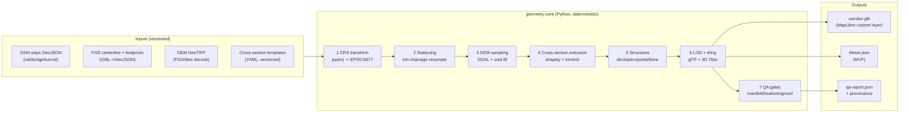

# 05a — Hành lang 3D thực từ dữ liệu mở + module geometry (実線区3D・ジオメトリ生成)

> Ngôn ngữ: tiếng Việt; thuật ngữ gốc tiếng Nhật trong ngoặc đơn. Mọi khẳng định về giấy phép, URL, thông số đều kèm link nguồn. Số liệu chưa kiểm chứng trực tiếp đánh dấu `[推定]`.

## 1) Phạm vi (範囲・スコープ)

**Câu hỏi cần trả lời:** có thể dựng hành lang 3D của tuyến thực (ở đây là đoạn quanh 根府川 (Nebukawa), 小田原市 (Odawara-shi), trên 東海道本線 (Tōkaidō Main Line) thực) bằng cách merge nhiều nguồn mở + một module sinh geometry (ジオメトリ生成モジュール) hay không — kể cả khi việc đó phức tạp.

**Đối tượng:**

- Hành lang dài 3,2 km, lý trình nội bộ km 12k400–15k600 (lý trình là hư cấu — fictional stationing — nhưng geometry đường ray là OSM thực, xem `frontend/src/geo.ts` và `data/rail_osm.json`).
- Cầu B-14 (hư cấu: trụ P1–P6, dầm G1–G5, mố A1/A2) và hầm T-07 (hư cấu) — cần thay bằng nhịp cầu/hầm thực suy ra từ tag OSM, hoặc giữ B-14/T-07 làm overlay nghiệp vụ trên nền thực.
- Ưu tiên của user: ảnh nền lấy từ chính tuyến ray thực (ảnh ưu tiên từ đường ray thực tế), không phải ảnh minh họa chung.

**Ngoài phạm vi:** point cloud drone (đã có `04b` quyết định loại khỏi demo), model AI phát hiện 変状 (xem `02-model.md`), chi tiết engine render (xem `04b-3d-viewer.md`). Báo cáo này không phải tư vấn pháp lý (法的助言ではない); bảng license cần pháp chế xác nhận trước khi dùng thương mại.

**Kết luận trước (đọc trong 1 phút):** làm được ở mức **visual context** (bối cảnh trực quan), không đạt survey-grade (cấp đo đạc). Công thức là: tim tuyến OSM thực + DEM GSI thực + nhịp cầu/hầm thực từ tag OSM + ray/tà vẹt/đá/ballast/cột điện procedural (手続き型生成) theo khổ 1.067 mm. PLATEAU không có cho 小田原 nên nhà 3D quanh tuyến phải lấy từ 基盤地図情報 (FGD) hoặc bỏ. Mọi kích thước procedural phải gắn nhãn 模式 (mô hình minh họa) / 参考値 (giá trị tham khảo).

---

## 2) Findings (調査結果)

### 2.1 OSM quanh 根府川: có gì thực trong `data/rail_osm.json`

File cache hiện tại (Overpass, `timestamp_osm_base` 2026-11-23, 67 phần tử, toàn bộ là way) chứa hai tuyến song song:

- **東海道本線 (Tōkaidō Main Line): 32 ways** — `gauge=1067`, `electrified=contact_line`, `voltage=1500`, `frequency=0` (điện một chiều DC), `operator=東日本旅客鉄道`, `usage=main`. Đây là thông số đúng của tuyến JR thường (xem mục 2.8).
- **東海道新幹線 (Tōkaidō Shinkansen): 30 ways** — `gauge=1435`, `voltage=25000`, `frequency=60`, `operator=東海旅客鉄道`. Tuyến này chạy gần như song song trong cùng bbox; khi dựng corridor phải **lọc `KSJ2:LIN=東海道本線` / `name=東海道本線`**, nếu không sẽ sinh nhầm ray Shinkansen lên cùng hành lang.

Tag cấu trúc (構造物タグ) có thực trong extract:

- `bridge=yes` × 13 đoạn, `bridge=viaduct` × 1 đoạn, `tunnel=yes` × 18 đoạn, `layer=1` × 10, `layer=-1` × 8.
- Hầm có tên thực (トンネル名): 南郷山トンネル, 片浦トンネル, 石橋山トンネル, 米神トンネル (mỗi tên xuất hiện 2 ways do chia đoạn hai chiều). Đây là các hầm thực quanh Nebukawa — ứng viên thay thế hầm hư cấu T-07.
- `service=siding/yard` × 5 (đường depot/ga lân cận — loại khỏi centerline chính khi merge).

Thứ **không có** trong extract (đã quét toàn bộ key): `embankment`, `cutting`, `man_made=retaining_wall`, `power=catenary_mast`, `railway=signal`, `railway=milestone`, `railway:position`, `railway=switch`, `bridge:structure`, `height`, `ele`. Quy tắc tagging cho các đối tượng này tồn tại trong chuẩn [OpenRailwayMap/Tagging](https://wiki.openstreetmap.org/wiki/OpenRailwayMap/Tagging) (`railway=signal` đặt node trên track kèm `railway:signal:direction`; cột điện `power=catenary_mast` dạng điểm; cột km `railway=milestone` + `railway:position`), và tag ray chuẩn gồm `gauge`/`electrified`/`frequency`/`voltage`/`bridge`/`tunnel`/`embankment`/`cutting` theo [Tag:railway=rail](https://wiki.openstreetmap.org/wiki/Tag:railway%3Drail) — nhưng **quanh tuyến nông thôn này cộng đồng chưa vẽ**, nên module phải coi chúng là procedural toàn bộ.

Hệ quả cho merge: OSM cho ta **tim tuyến + phạm vi nhịp cầu/hầm (điểm đầu–cuối đoạn có tag) + khổ ray + điện khí hóa**. Mọi thứ còn lại (trụ cầu ở đâu, hầm tiết diện bao nhiêu, cột điện cách bao xa) OSM không trả lời.

### 2.2 国土数値情報 鉄道データ (N02): tuyến tham chiếu, không phải chi tiết

- Nội dung: toàn quốc, tuyến旅客鉄道・軌道 (đường sắt chở khách) dạng **đường (線)**, thuộc tính `N02_001` 鉄道区分, `N02_002` 事業者種別, `N02_003` 路線名, `N02_004` 運営会社, kèm 駅 (ga) với `N02_005` 駅名 — xem [trang dataset N02-2025](https://nlftp.mlit.go.jp/ksj/gml/datalist/KsjTmplt-N02-2025.html). Bản 2025 (chuẩn 31/12/2025) toàn quốc chỉ **14,2 MB**.
- Hệ tọa độ JGD2011/(B,L); định dạng GML (JPGIS2014), Shapefile, GeoJSON (từ 2016).
- License: bản từ 2020 trở đi là **CC BY 4.0** (ghi rõ trên trang dataset: "2020年以降: オープンデータ (CC_BY_4.0)").
- **Thiếu:** khổ ray, số đường, cầu/hầm, cao độ, lý trình km. Hình học tuyến lấy từ 数値地図25000 + 電子地形図タイル + 鉄道要覧 nên là tuyến sơ đồ (schematic), thô hơn OSM ở đoạn cong ven biển. Vai trò trong module: **lớp đối chiếu tên tuyến/ga**, không làm alignment chính.

### 2.3 基盤地図情報 (FGD): nguồn centerline tốt nhất trong các nguồn mở

- Dịch vụ [基盤地図情報ダウンロードサービス](https://service.gsi.go.jp/kiban/app/) (đăng ký miễn phí) cung cấp hai nhóm cần thiết: **基本項目** chứa 軌道の中心線 (tim đường ray) + 建築物の外周線 (chu vi nhà) + 標高点, và **数値標高モデル** (DEM 5 m/10 m) — xem [help FGD](https://service.gsi.go.jp/kiban/app/help/). Định dạng JPGIS (GML), cần convert sang Shape/GeoTIFF bằng viewer hoặc GDAL.
- Vì là 基本測量成果, **tái phân phối/offline có thể cần thủ tục 測量法** — tra cứu qua [judge navigation onestop](https://service.gsi.go.jp/onestop/judg_application/) trước khi đóng gói air-gap.
- Tình trạng phủ 軌道の中心線 đúng ô Nebukawa **[推定] cần kiểm tra 1 lần trên download service** (FGD phủ không đồng đều theo vùng/năm đo). Nếu có, đây là alignment chính xác nhất trong các nguồn mở (cấp 1/2.500, tốt hơn node OSM thưa).

### 2.4 Địa hình DEM (数値標高モデル・標高タイル)

Hai đường lấy DEM:

- **FGD DEM file (GML):** DEM5A (laser hàng không), DEM5B/5C (đo ảnh), DEM10A/10B (đường đồng mức) — tải theo mesh từ [download service](https://service.gsi.go.jp/kiban/app/).
- **標高タイル XYZ** (nhanh, không đăng ký): `dem_png` (DEM10B), `dem5a_png/dem5b_png/dem5c_png`, zoom 5A/5B tới 15, 10B tới 14. Công thức decode PNG đã xác minh trên [spec GSI](https://maps.gsi.go.jp/development/demtile.html): `x = 2^16·R + 2^8·G + B`; `h = 0,01·x` (m); điểm vô hiệu `(R,G,B) = (128,0,0)`. Đây là bản **làm mịn tuyến tính từ FGD DEM**, không thay thế file gốc khi cần chính xác.

Độ chính xác (RMS, theo [FAQ GSI](https://www.gsi.go.jp/kiban/faq)):

- DEM5A: **0,3 m以内** (ô lưới không có điểm laser: 2,0 m); DEM5B: 0,7 m; DEM5C: 1,4 m; DEM10A: 2,5 m; DEM10B: 5,0 m. "5 m" là **khoảng lưới, không phải精度**.
- Ven biển Nebukawa (vách đá + ray đắp cao) DEM 5–10 m sẽ **làm mờ taluy và mặt ray**; DEM chỉ làm nền địa hình + cao độ tham chiếu, **không làm datum cao độ ray**.
### 2.5 Ảnh (画像・オルソ写真): ưu tiên ảnh tuyến thực

- **GSI 全国最新写真 (シームレス空中写真)** là đáp án cho "ảnh từ chính tuyến thực": phủ toàn quốc tới zoom 18, URL `https://cyberjapandata.gsi.go.jp/xyz/seamlessphoto/{z}/{x}/{y}.jpg` — xem [一覧 GSI](https://maps.gsi.go.jp/development/ichiran.html). Thuộc nhóm 基本測量成果以外 nên theo コンテンツ利用規約 + điều kiện từng nguồn ảnh gốc; realtime + attribution thì dùng được cho demo.
- Giới hạn honesty: ảnh có thể cũ/mờ ở nông thôn, không thấy chi tiết ray/tà vẹt ở zoom 18 (độ phân giải [推定] ~0,5 m/px). Ảnh GSI là **bối cảnh**, không thay ảnh kiểm tra drone. Nếu cần mặt đất: Mapillary (CC BY-SA, ShareAlike) chỉ làm link/viewer ngoài scene (đã phân tích trong `04a`).

### 2.6 PLATEAU quanh tuyến: không có 小田原 — quyết định quan trọng

Danh sách [PLATEAU Open Data](https://www.mlit.go.jp/plateau/open-data/) (306 địa điểm, cập nhật 11/05/2026) cho 神奈川県 chỉ gồm: 藤沢市, 厚木市, 横浜市, 川崎市, 鎌倉市, 相模原市, 横須賀市, 箱根町 — **không có 小田原市 (Odawara-shi)**. Corridor 根府川 nằm trong Odawara-shi nên:

- Không có CityGML/3D Tiles nhà, không có LOD mái/texture cho đoạn 3,2 km.
- Thay thế: **FGD 建築物の外周線** (footprint 2D, không chiều cao → đùn khối với chiều cao mặc định [推定] 6–9 m và gắn nhãn 模式) hoặc OpenFreeMap vector buildings (OSM, thưa ở quê). Cả hai chỉ là bối cảnh, không phải mô hình nhà thật.
- Không tải PLATEAU về cho demo này; giữ PLATEAU làm fallback cho tuyến đô thị khác trong MVP.

### 2.7 Dữ liệu点検 cầu/hầm mở của MLIT: đường bộ, không phải đường sắt

Nguồn mở duy nhất cùng họ là [全国道路施設点検データベース〜損傷マップ](https://road-structures-map.mlit.go.jp/) (vị trí + 諸元 + kết quả点検 cầu đường bộ/hầm đường bộ, dữ liệu 05/11/2026) và [道路メンテナンス年報](https://www.mlit.go.jp/road/sisaku/yobohozen/yobohozen_maint_r07.html). Cả hai **chỉ cho道路 (đường bộ)**, và điều khoản 損傷マップ cấm dùng thương mại/sao chép. **Kết luận: không có database mở cho寸法 cầu/hầm đường sắt JR.** Kích thước B-14/T-07 (hoặc nhịp thực thay thế) bắt buộc lấy từ khách hàng (bản vẽ 竣工図) hoặc đo drone + GCP.

### 2.8 Cái gì sinh được từ mỗi nguồn (hình học nào là tag thực, cái nào procedural)

Chuẩn ray JR thường khổ 1.067 mm: ray 50N phổ biến, tà vẹt cách nhau ~600 mm, đá ballast dày ~250 mm dưới tà vẹt (giá trị đại diện, không phải spec toàn mạng). Điện khí hóa 東海道本線 là DC 1.500 V (khớp `voltage=1500/frequency=0` trong extract).

| Bộ phận | Nguồn mở cho | Cách sinh | Tag thực hay procedural |
|---|---|---|---|
| Tim tuyến (中心線) | OSM way geometry / FGD 軌道の中心線 | Resample + nội suy cong | Tag thực (OSM/FGD); nội suy là tính toán |
| Hai ray | Khổ `gauge=1067` từ OSM | Offset ±533,5 mm theo pháp tuyến, đùn tiết diện ray | Procedural, tham số thực |
| Tà vẹt (枕木) | `gauge` + quy tắc 600 mm | Instancing hộp dọc tuyến | Procedural (kích thước [推定]) |
| Đá ballast (道床) | Quy tắc mặt cắt ~250 mm | Đùn mặt cắt hình thang | Procedural ([推定]) |
| Mặt bằng ga/đường depot | `service=siding/yard` | Vẽ thêm đường song song | Nửa thực (vị trí) + procedural |
| Sàn cầu + mố (橋桁・橋台) | Đoạn `bridge=yes/viaduct` (điểm đầu–cuối) | Sàn hộp theo span; mố hộp tại 2 đầu | Vị trí thực, kích thước procedural |
| Trụ cầu (橋脚) | Không có gì (OSM không lưu số trụ) | Chia đều span theo nhịp giả định [推定] 20–30 m | Procedural, gắn nhãn 模式 |
| Vỏ hầm + cửa hầm (覆工・坑門) | Đoạn `tunnel=yes` + tên hầm | Ống tiết diện chữ U/vòm + mặt cửa hầm hộp | Procedural ([推定] rộng 1 đường ~6 m, 2 đường ~10 m) |
| Tường chắn (擁壁) | Không có tag | Tường procedural dọc taluy DEM dốc | Procedural, cần xác nhận hiện trường |
| Cột + dây điện (架線柱・トロリ線) | Không có node trong extract | Cột cách [推定] 40–50 m xen kẽ 2 bên, dây ở cao 5,0 m trên đỉnh ray | Procedural hoàn toàn |
| Tín hiệu (信号機) | Chuẩn tag tồn tại nhưng vùng này không vẽ | Hộp tín hiệu placeholder tại ranh block [推定] | Procedural, ghi rõ phi khảo sát |
| Cột km (キロ程標) | Chuẩn `railway=milestone` tồn tại nhưng không vẽ | Sinh từ lý trình mỗi 100 m (visual) | Tính toán, không phải測量 |
| Nhà bối cảnh | FGD 建築物の外周線 | Đùn khối cao mặc định | Footprint thực, chiều cao [推定] |

### 2.9 Thư viện cho module (đã đối chiếu khả năng)

- **pyproj** (CRS: WGS84 ↔ 平面直角座標系第IX系 EPSG:6677 cho Kanagawa) + **GDAL** (đọc GML FGD, warp DEM, VRT mosaic) + **shapely** (offset/pháp tuyến/nội suy) + **trimesh/numpy** (đùn mặt cắt, xuất glTF/GLB) — stack thuần Python, cài bằng pip, chạy offline.
- **osm2world**: converter OSM→3D có thật, xuất glTF/OBJ, có module đường sắt đọc tag `railway/bridge/tunnel` (xem [OSM2World docs](https://osm2world.org/docs/)) — dùng làm **tham chiếu/preview**, không làm core vì chi tiết cầu/hầm sơ sài và là Java.
- **Terrain mesh**: `tumgis/ctb-quantized-mesh` (Docker, `ctb-tile -f Mesh`) sinh quantized-mesh từ GeoTIFF theo [quy trình CTB](https://github.com/tum-gis/cesium-terrain-builder-docker); MapLibre ăn terrain qua `raster-dem` (Terrarium) hoặc adapter quantized-mesh — xem [custom layer + terrain docs](https://maplibre.org/maplibre-gl-js/docs/examples/add-3d-tiles-3d-objects-and-models-using-threejs/).
- **Render trong demo hiện tại:** MapLibre custom layer (`type: 'custom'`, `renderingMode: '3d'`, dùng chung WebGL context, `autoClear=false`, `resetState()` trước khi vẽ) theo [CustomLayerInterface](https://maplibre.org/maplibre-gl-js/docs/API/interfaces/CustomLayerInterface/) — khớp kiến trúc `04b` (MapLibre + Three.js corridor).

---

## 3) Bảng so sánh (比較表)

### 3a. Ma trận nguồn dữ liệu

| Nguồn | Lớp dùng | Phủ quanh 根府川 | License | Cung cấp (提供) | Thiếu (不足) | Effort lấy về |
|---|---|---|---|---|---|---|
| OSM rail (Overpass 1-shot, đã cache) | `railway=rail` + bridge/tunnel/layer/gauge | ◎ (67 ways, cả 本線+新幹線) | ODbL; attribution `© OpenStreetMap contributors` ([copyright](https://www.openstreetmap.org/copyright/sp), [Produced Work guideline](https://osmfoundation.org/wiki/Licence/Community_Guidelines/Produced_Work_-_Guideline)) | Tim tuyến, nhịp cầu/hầm, khổ ray, điện khí hóa | Trụ/mố, tiết diện hầm, cột/tín hiệu/cột km, embankment/cutting | Thấp (đã có file; query lại khi cần) |
| KSJ N02 鉄道データ | RailroadSection + Station | ◎ toàn quốc, 14,2 MB | CC BY 4.0 (bản ≥2020) ([N02-2025](https://nlftp.mlit.go.jp/ksj/gml/datalist/KsjTmplt-N02-2025.html)) | Tên tuyến/ga đối chiếu | Mọi chi tiết hình học | Thấp (tải 1 lần) |
| FGD 軌道の中心線 | 基本項目 | ○ [推定] cần check ô Nebukawa | 基本測量成果 — có thể cần承認 測量法 khi tái phân phối ([onestop judge](https://service.gsi.go.jp/onestop/judg_application/)) | Centerline chính xác nhất | Cao độ ray, cấu trúc | Trung bình (đăng ký + convert GML) |
| FGD 建築物の外周線 | 基本項目 | ○ [推定] | Như trên | Footprint nhà bối cảnh | Chiều cao nhà | Trung bình (chung đợt tải FGD) |
| GSI DEM file (5A/5B/5C/10B) | 数値標高モデル | ○ (loại 5A hay 5C tùy ô) | 基本測量成果,同上 | Địa hình 5–10 m (RMS 0,3–5 m, [FAQ](https://www.gsi.go.jp/kiban/faq)) | Mặt ray, taluy chi tiết | Trung bình (0,5–1 ngày convert) |
| GSI 標高タイル | `dem_png/dem5a_png…` | ◎ XYZ toàn quốc | Terms GSI + 測量法 khi cache/phân phối ([terms](https://www.gsi.go.jp/kikakuchousei/kikakuchousei40182.html)) | Cao độ nhanh cho prototype (decode theo [spec](https://maps.gsi.go.jp/development/demtile.html)) | Độ mịn (bản làm mịn), void `(128,0,0)` | Thấp (vài giờ) |
| GSI 全国最新写真 | `seamlessphoto` z14–18 | ◎ | コンテンツ利用規約 + điều kiện nguồn ảnh ([一覧](https://maps.gsi.go.jp/development/ichiran.html)) | Ảnh chính tuyến thực (bối cảnh) | Chi tiết ray, độ tươi | Thấp (gắn URL) |
| PLATEAU | CityGML/3D Tiles | ✗ (không có 小田原; Kanagawa chỉ 8 TP/thị trấn khác — [open-data list](https://www.mlit.go.jp/plateau/open-data/)) | Từng dataset (CC BY 4.0…) | Không có gì cho corridor này | Toàn bộ nhà 3D | Không làm (ghi rõ lý do) |
| MLIT 損傷マップ/年報 | Cầu/hầm đường bộ | △ (đường bộ quanh vùng) | Cấm thương mại/sao chép (terms trong map) | Tham khảo quy trình点検 | Mọi寸法 đường sắt | Không dùng geometry |
| Khách hàng/drone/GCP | 竣工図, 検測車, drone + 標定点 | ◎ (khi được cấp) | Theo hợp đồng | Kích thước thật, datum mm | — | Ngoài scope 2 ngày |

### 3b. So sánh phương án render corridor thực

| Phương án | Kết quả | License/effort | Khi nào chọn |
|---|---|---|---|
| A. Procedural rails + DEM + OSM structures trên MapLibre custom layer (khuyến nghị) | Ray/tà vẹt/ballast thực vị trí, cầu/hầm hộp 模式 trên nền ảnh thực | Toàn mở; 1–2 eng, 2 ngày slice + 2–4 tuần MVP | Demo 26/11 + MVP visual |
| B. + FGD centerline/footprint thay OSM | Tim tuyến chính xác hơn, nhà footprint thực | Cần đăng ký FGD + check 測量法; +0,5–1 ngày | Ngay khi tải được FGD |
| C. osm2world render toàn bộ OSM bbox | Nhanh có 3D tổng thể | Java tool ngoài, chi tiết cầu/hầm yếu | Chỉ preview nội bộ |
| D. Survey-grade (drone + GCP + 竣工図) |  point cloud +寸法 thật, defensible mm–cm | Cần bay/đo/quyền site; nhiều tuần | MVP S2, khi có dữ liệu thật |

---

## 4) Khuyến nghị (推奨)

**Xây module geometry — nhưng đóng khung "minimal real 3D" (thực vị trí, minh họa kích thước), không phải survey-grade:**

1. Alignment: OSM 東海道本線 đã lọc → nâng lên FGD 軌道の中心線 khi tải được. Lưu EPSG:4326, render EPSG:3857, đo đạc dùng 平面直角座標系第IX系 (EPSG:6677).
2. Địa hình: DEM tile GSI decode nhanh cho slice 2 ngày; FGD DEM → quantized-mesh/Terrarium tự host cho MVP.
3. Cấu trúc: nhịp cầu/hầm thực từ tag OSM (hầm 南郷山/片浦/石橋山/米神 + nhịp `bridge=yes`); trụ/dầm/cửa hầm = hộp procedural + nhãn「寸法は模式」.
4. Bối cảnh: GSI seamlessphoto + FGD footprint đùn khối; **không hứa PLATEAU** cho tuyến này.
5. Mọi số procedural vào `templateVersion` + QA report; UI disclaimer「参考値・位置未確定」tới khi có 竣工図/GCP.

---

## 5) Kiến trúc / đặc tả module (構成・仕様)

### 5.1 Pipeline



### 5.2 Input schema (khóa hợp đồng module)

```ts
// corridor-input.ts — lưu kèm mỗi lần build, hash đưa vào qa-report
interface CorridorInput {
  inputVersion: string;
  templateVersion: string;
  crs: "EPSG:4326";
  alignment: { km_m: number; lon: number; lat: number }[];
  demSource: "GSI-dem5a-tile" | "FGD-DEM5A" | "FGD-DEM10B";
  gauge_mm: 1067;
  structures: {
    id: string;
    kind: "bridge" | "tunnel" | "earthwork";
    kmStart_m: number; kmEnd_m: number;
    source: "osm-tag" | "client-drawing" | "assumed";
    params?: Record<string, number>;
  }[];
}
```

```python
# geometry-core sketch (Python 3.12, pyproj/GDAL/shapely/trimesh)
@dataclass(frozen=True)
class CrossSection:
    gauge_mm: float = 1067.0
    rail_head_w: float = 0.065
    sleeper_dx: float = 0.60
    ballast_depth: float = 0.25

def extrude_alignment(pts_6677: np.ndarray, xs: CrossSection) -> trimesh.Scene: ...
def place_piers(span_km: tuple[float, float], bay_m: float = 25.0) -> trimesh.Scene: ...
def build_qa_report(...) -> QAReport: ...
```

### 5.3 Quy tắc QA + determinism (bắt buộc)

- Deterministic: seed cố định; cùng `(inputVersion, templateVersion, codeVersion)` → cùng bytes GLB (hash SHA-256 trong report).
- QA gates: stationing đơn điệu; mặt cắt khép kín; mesh manifold (`is_watertight`); DEM void < 5% nếu không FAIL + fallback phẳng; mọi phần tử procedural mang `source: assumed` + nhãn 模式.
- Versioning: `templates/v1.0/*.yaml` + `inputs/<date>-<hash>/` + `qa-report.json`; không sửa template mà không bump version.

---

## 6) Kế hoạch 2 ngày (2日スライス) vs MVP

### Lát 2 ngày (gắn vào demo MapLibre hiện tại, không phá demo)

| # | Việc | Nguồn + lib | Xong khi |
|---|---|---|---|
| 1 | Lọc 東海道本線 khỏi OSM cache, tách centerline 2 track (本線 vs 新幹線), sinh ray đôi + tà vẹt instancing + ballast dọc 3,2 km | `data/rail_osm.json`, shapely resample, three.js `InstancedMesh` trong custom layer có sẵn | Ray hiện trên ảnh GSI thực, đúng vị trí OSM |
| 2 | Nhịp cầu/hầm thực: sàn hộp trên đoạn `bridge=yes/viaduct`, ống hầm + mặt portal trên đoạn `tunnel=yes` (ghi tên hầm thực) | OSM spans, three.js BoxGeometry, DEM sample cao độ | B-14/T-07 hư cấu được thay/gắn với span thực |
| 3 | Nền DEM: sample `dem_png`/`dem5a_png` dọc tuyến, drap ray + terrain mesh thô (Terrarium tự convert hoặc phẳng + exaggeration nếu lỗi void) | GSI tiles, công thức [demtile spec](https://maps.gsi.go.jp/development/demtile.html) | Ray không chìm/nổi quá [推定] ±2 m so với ảnh |
| 4 | Attribution + disclaimer: `© OpenStreetMap contributors · 地理院タイル（国土地理院）· 寸法は模式・参考値` thường trực + About dialog | — | Thiếu là FAIL demo |

### MVP 2–4 tuần (1–2 engineers)

| Tuần | Việc | Exit |
|---|---|---|
| 1 | FGD 軌道の中心線 + footprints + DEM file Nebukawa; thay alignment OSM; thủ tục 測量法 cho offline | Alignment FGD + report phủ |
| 2 | geometry-core Python (extrude + structures + QA + GLB deterministic) + test fixtures | `corridor.glb` build lại cho hash trùng |
| 3 | LOD + tileset + tích hợp viewer (click trụ/marker ↔ panel), nhà footprint đùn khối | 60 fps [推定] ở zoom 14–16, fallback 2D |
| 4 | Đối chiếu 竣工図/GCP đầu tiên (nếu khách cấp); error budget công bố; docs air-gap | Bảng sai số + nhãn survey/procedural rõ ràng |

---

## 7) Rủi ro (リスク)

| # | Rủi ro | Mức | Giảm thiểu |
|---|---|---|---|
| 1 | Nhầm visual với測量: stakeholder đọc kích thước procedural như số thật | Cao nhất | Nhãn 模式 trên mọi solid + template version + QA report |
| 2 | OSM lệch [推定] vài m; DEM làm mịn taluy → ray "bay" khỏi ảnh | Cao | Error budget; check visual 3 điểm cầu/hầm; không đo mét trên Web Mercator |
| 3 | Shinkansen song song → sinh nhầm track | Trung bình | Lọc `name=東海道本線` + `gauge=1067` trong code, test assert không còn `gauge=1435` |
| 4 | FGD ô Nebukawa thiếu 軌道の中心線 / DEM5A | Trung bình | Check download service ngày 1; fallback OSM + DEM tile đã định |
| 5 | Thủ tục 測量法 khi đóng gói offline (FGD/GSI) | Trung bình | Chỉ realtime trong demo; tra onestop-judge trước MVP; attribution đầy đủ |
| 6 | ODbL ShareAlike nếu phát hành Derivative Database (GLB tái trích xuất được) | Trung bình | Giữ lớp OSM-derived tách biệt (collective DB), attribution, sẵn sàng công bố OSM-derived dataset theo [Produced Work guideline](https://osmfoundation.org/wiki/Licence/Community_Guidelines/Produced_Work_-_Guideline) |
| 7 | PLATEAU 小田原 vắng mặt gây thất vọng "nhà 3D đâu" | Thấp (sau báo cáo này) | Nói trước + footprint FGD thay thế; mục 2.6 làm bằng chứng |

---

## 8) References (参考文献・URL一覧)

- OSM Tag railway=rail (gauge/electrified/bridge/tunnel/embankment/cutting): <https://wiki.openstreetmap.org/wiki/Tag:railway%3Drail>
- OpenRailwayMap Tagging (signal/mast/milestone/switch): <https://wiki.openstreetmap.org/wiki/OpenRailwayMap/Tagging>
- OSM Copyright/ODbL + attribution: <https://www.openstreetmap.org/copyright/sp>
- OSMF Produced Work guideline (render vs Derivative DB): <https://osmfoundation.org/wiki/Licence/Community_Guidelines/Produced_Work_-_Guideline>
- KSJ N02 鉄道データ 2025 (CC BY 4.0, 14,2 MB, JGD2011): <https://nlftp.mlit.go.jp/ksj/gml/datalist/KsjTmplt-N02-2025.html>
- FGD download service (軌道の中心線・建築物の外周線・DEM): <https://service.gsi.go.jp/kiban/app/> + help: <https://service.gsi.go.jp/kiban/app/help/>
- GSI DEM accuracy FAQ (RMS 0,3/0,7/1,4/2,5/5,0 m): <https://www.gsi.go.jp/kiban/faq>
- GSI 標高タイル decode spec (x=2^16R+2^8G+B, void (128,0,0)): <https://maps.gsi.go.jp/development/demtile.html>
- GSI tile list + terms (std/seamlessphoto/dem_png): <https://maps.gsi.go.jp/development/ichiran.html>
- GSI contents terms + 測量法 (コンテンツ利用規約): <https://www.gsi.go.jp/kikakuchousei/kikakuchousei40182.html>
- 測量成果 onestop judge (reproduction/use approval): <https://service.gsi.go.jp/onestop/judg_application/>
- PLATEAU open-data list (306 sites, không có 小田原市 — Kanagawa: 藤沢・厚木・横浜・川崎・鎌倉・相模原・横須賀・箱根): <https://www.mlit.go.jp/plateau/open-data/>
- MLIT road inspection damage map (đường bộ only): <https://road-structures-map.mlit.go.jp/>
- MLIT road maintenance annual report R7: <https://www.mlit.go.jp/road/sisaku/yobohozen/yobohozen_maint_r07.html>
- OSM2World docs (OSM→glTF/OBJ, railway module): <https://osm2world.org/docs/>
- MapLibre CustomLayerInterface (renderingMode 3d, shared context): <https://maplibre.org/maplibre-gl-js/docs/API/interfaces/CustomLayerInterface/>
- MapLibre three.js + 3D Tiles example: <https://maplibre.org/maplibre-gl-js/docs/examples/add-3d-tiles-3d-objects-and-models-using-threejs/>
- CTB quantized-mesh Docker (terrain generation): <https://github.com/tum-gis/cesium-terrain-builder-docker>
- Repo hiện tại: `frontend/src/geo.ts`, `frontend/src/MapView.tsx`, `data/rail_osm.json`, `docs/research/04a-free-geo-data.md`, `docs/research/04b-3d-viewer.md`

---

## KEY DECISIONS (≤8)

1. Corridor 3D "thực vị trí" từ open data ở mức visual context — không survey-grade nếu thiếu 竣工図/drone/GCP.
2. Alignment: OSM 東海道本線 lọc gauge=1067 ngay; nâng lên FGD 軌道の中心線 khi tải được.
3. Nhịp cầu/hầm thực từ tag OSM (spans + hầm 南郷山/片浦/石橋山/米神); trụ/dầm/tiết diện procedural + nhãn 模式.
4. Không có PLATEAU cho 小田原 — nhà bối cảnh = FGD footprint đùn khối.
5. Cột điện/tín hiệu/cột km/tường chắn procedural toàn bộ; cấm ghi như số đo.
6. geometry-core Python deterministic + QA gates + versioned templates; render qua MapLibre custom layer hiện có.
7. Ảnh thực = GSI seamlessphoto; DEM nhanh =標高タイル, DEM chuẩn = FGD file + thủ tục 測量法 cho offline.
8. Lớp OSM-derived tách biệt, attribution thường trực, sẵn sàng công bố dataset phái sinh theo ODbL.

## OPEN QUESTIONS (≤8)

1. FGD ô Nebukawa có 軌道の中心線 + DEM5A không? (check ngày 1)
2. Khách có cấp 竣工図 + 検測車/GCP trước MVP S2 không?
3. Giữ nhãn B-14/T-07 hư cấu trong panel, hay đổi sang tên thực hoàn toàn?
4. DEM tile đủ cho slice 2 ngày, hay phải convert FGD DEM ngay?
5. Chiều cao đùn footprint mặc định bao nhiêu? ([推定] 6–9 m)
6. Cột điện procedural hiện trong demo 26/11 hay giấu tới MVP?
7. Phát hành GLB có bị coi là Derivative Database (ShareAlike)? (cần pháp chế)
8. Offline cần承認 測量法 nào cho cache GSI + FGD? (tra onestop-judge trước)
